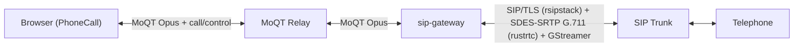
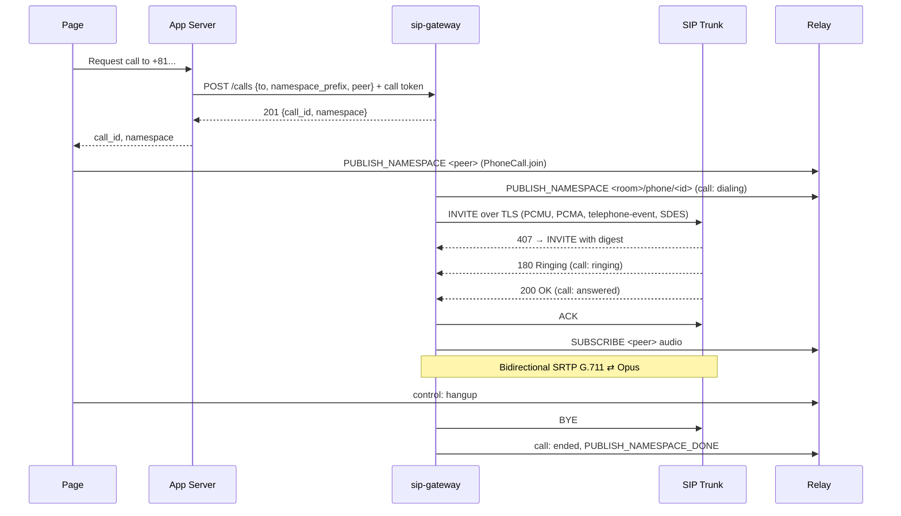

# Design: SIP Gateway Bridging Phone Calls into MoQT Rooms

## Status
Accepted (2026-11-20)

## Scope
`services/sip-gateway` places and answers phone calls over a SIP trunk and bridges each call's audio to a MoQT broadcast.

Collaborating crates:
- `crates/broadcast`: `BroadcastReader` (shared with `egress-gateway`).
- `crates/auth-token`: `calls` claim.
- `crates/app-registry`: per-app phone numbers (`numbers`, `callWebhook`, `allowedDestinations`).
- `sdk/js/js`: `PhoneCall` API.

Each call links one phone to one MoQT peer. Out of scope: video, multi-peer mixing, call transfer, fax, emergency calling, and number provisioning.

## Context
Existing room services (`recorder`, AI bots, `live-translate`) operate on MoQT Opus broadcasts. Telephones speak SIP + G.711 RTP. Exposing each phone call as a standard broadcast in the room makes calls recordable, translatable, and bot-answerable without modifying those services.

`rsipstack` handles RFC 3261 SIP transactions/dialogs over TLS, 401/407 digest auth, and re-INVITE, but carries no media and does not run RFC 4028 session timers (`Session-Expires` is only a header).

**Jump to:** [Topology](#topology) · [Auth & API](#authorization--http-api) · [Call Flows](#outbound--inbound-call-flows) · [SIP Trunk](#sip-trunk--local-test-trunk) · [Call Control](#call-control-call--control-tracks) · [Media & Timers](#media--session-timers) · [Modules & Settings](#modules-settings-deployment--telemetry) · [Alternatives](#alternatives--open-questions)

## Decision

### Topology



- **Phone leg**: Published by the gateway as `<room>/phone/<call_id>` (MSF catalog, Opus `audio` track, `call` track). Pages observe join/leave via `PUBLISH_NAMESPACE` / `PUBLISH_NAMESPACE_DONE`.
- **Peer leg**: Subscribed by the gateway from `<peer>`, a per-call broadcast published by the page (microphone audio + `control` track).

### Authorization & HTTP API
To prevent toll fraud, pages never dial directly. Like bots ([`bot-dispatcher/architecture.md`](../bot-dispatcher/architecture.md)), the app server calls `POST /calls` with a short-lived JWT signed with the app secret carrying the `calls` claim (relative namespace prefix; absent = denied).

- Gateway verifies via VTS, checks `to` is E.164 and matches `allowedDestinations`, and enforces per-app concurrency and max duration limits.
- Gateway joins the relay with a self-signed client token (`publish: <room>/phone/<call_id>`, `subscribe: <peer>`, lifetime = max call duration + 5 min).
- Outbound `INVITE` uses the app's first registered number as caller ID, or `anonymous`.

`POST /calls` body: `{to, namespace_prefix, peer}` (`peer` must lie in the room and not under `<room>/phone`). Returns `201 {call_id, namespace}` immediately, or:

| Status | `error` | When |
| --- | --- | --- |
| `400` | `invalid_request`, `invalid_destination`, `invalid_peer` | Malformed body, non-E.164 `to`, or `peer` outside room |
| `401` | `a bearer token is required`, `invalid_token`, `invalid_token_lifetime` | Missing token, VTS rejection, or lifetime > 5 min |
| `403` | `forbidden`, `destination_not_allowed` | Missing `calls` claim for room, relay token, or disallowed `to` |
| `429` | `too_many_calls` | Per-app concurrent call limit reached |
| `500` | `internal_error` | Call startup failed |
| `503` | `vts_unavailable`, `registry_unavailable` | Dependency unreachable |

### Outbound & Inbound Call Flows

#### Outbound Call


#### Inbound Call
Inbound `INVITE` checks: non-allowlisted signalling IP → `403`; unregistered DID → `404`; per-app call limit reached → `486`; offer lacking SDES-SRTP or G.711 → `488`. Otherwise the gateway replies `180 Ringing` and calls the app's `callWebhook`:

```http
POST <callWebhook>
Authorization: Bearer <HS256 JWT signed with app secret: {appId, callId, from, to, iat, exp = iat + 5 min}>

{"call_id": "...", "from": "+8190...", "to": "+8150..."}
```

`from` is the trunk caller ID or `anonymous` (claims mirror the body for verification). The app server has up to 60 s (ringing timeout) to respond:

| Webhook response | Gateway action |
| --- | --- |
| `200 {"namespace_prefix": "<app>/<room>", "peer": "<broadcast>"}` | Publishes `<room>/phone/<call_id>` (`ringing`), sends SIP `200 OK` + SDP answer, moves to `answered` on `ACK` |
| `200 {"reject": "busy"}` / `{"reject": "decline"}` | SIP `486` / `603` |
| Timeout, other status, or invalid body | SIP `480` |
| Room outside app or peer outside room | SIP `500` |

A trunk `CANCEL` during webhook wait aborts cleanly with no broadcast. After `200 OK`, inbound calls follow the same lifecycle as outbound calls.

### SIP Trunk & Local Test Trunk
Target trunk: **Twilio Elastic SIP Trunking** with Secure Trunking enabled (configurable host, credentials, and signalling IPs so other matching trunks need no code changes; `REGISTER` is omitted until needed):

| Concern | Twilio / Gateway behavior |
| --- | --- |
| Authentication | No `REGISTER`; outbound challenges answered with digest auth (401/407) |
| Inbound routing | Fixed public TLS listener (`5061`); accepts `INVITE` only from configured signalling IPs |
| Codecs | Offers `PCMU` then `PCMA`; answer selects one |
| Security | SIP over TLS (`5061`) + SDES-SRTP (`a=crypto`, RFC 4568) only; unencrypted answers get `488` |
| DTMF | RFC 2833 / 4733 `telephone-event` only (never in-band) |

**Local trunk (`tests/sip-gateway-e2e/`)**: Runs containerized Asterisk PJSIP (`andrius/asterisk:22-cert`) with generated CA TLS on 5061, `media_encryption=sdes`, digest auth, `ulaw`/`alaw`, `rfc4733`, 90 s session timers, and a test dialplan (echo, 1 kHz tone, busy, 2 s hangup, DTMF `5` hangup, inbound originate). `run.sh` verifies both a Rust client and Chromium running `examples/browser/examples/phone` (`app-server.mjs`), including 100 s calls across 90 s session-timer refreshes.

### Call Control (`call` & `control` Tracks)
Call control uses standard MoQT tracks—no call semantics are added to MoQT, and namespace presence alone does not mean "ringing".

#### `call` Track (Gateway → Room)
One JSON object per state change, each its own closed group (`Broadcast::send_group`). Late joiners read current state via `subscribe_current_group`; `moqt::Session::close` waits for stream ACKs so `ended` reaches the relay.

- `state`: `dialing` | `ringing` | `answered` | `ended`
- `reason` (when `ended`): SIP final status (`486`, `488`, …), `hangup` (trunk `BYE` or peer broadcast ended), `timeout` (60 s no answer or 30 s trunk RTP silence), `limit` (max duration), `gateway` (`SIGTERM` or internal failure).

#### `control` Track (Page → Gateway)
One JSON object per group: `{"event":"hangup"}` or `{"event":"dtmf","digit":"1"}`.

- Subscribed from current group so an early `hangup` still ends the call; stale DTMF digits in the initial group are skipped.
- Each DTMF digit replaces audio with 5 packets (100 ms) using the negotiated `telephone-event/8000` payload type, followed by 3 final `E`-bit packets (RFC 4733 §2.5.1.4); dropped if trunk rejected `telephone-event`.
- Pages hang up via `control` (keeping their shared session alive); tab close triggers hangup via `PUBLISH_NAMESPACE_DONE`.

#### Browser SDK (`moq-wasm/media` `PhoneCall`)
Wraps `createBroadcast` (mic), `RemoteBroadcast` (phone audio), `publishTrack`/`writeGroup` (`control`), and `subscribeCurrentGroup` (`call`) ([`wasm/browser-sdk.md`](../wasm/browser-sdk.md)):

```ts
const call = await PhoneCall.join(session, {
  call: ['app', 'room', 'phone', callId],
  local: ['app', 'room', 'alice', 'call', callId],
  audio: microphoneTrack,
})
call.listen((state, reason) => {}) // dialing | ringing | answered | ended
await call.sendDtmf('1')
await call.hangUp()
```

### Media & Session Timers

#### Media Pipeline
- **Phone → MoQT**: 20 ms G.711 RTP → GStreamer (`mulawdec`/`alawdec`, `audioresample`, `opusenc`) → 48 kHz Opus LOC objects via `broadcast`. Capture timestamps step 20 ms from first published frame (no RTCP SR).
- **MoQT → Phone**: `BroadcastReader` with `VideoChoice::Off` (prevents meeting peers from encoding video) → `opusdec` → 8 kHz G.711 → 20 ms playout buffer (starts at 40 ms, drops oldest down to 40 ms above 120 ms; emits comfort silence when empty so trunks do not drop idle RTP). Subscribed from `LargestObject` with short `DELIVERY TIMEOUT`.

#### Teardown & RFC 4028 Session Timers (`sip_trunk/session_timer`)
- **Teardown triggers**: `BYE` from either side, peer `hangup` or `PUBLISH_NAMESPACE_DONE` (sends `CANCEL` if ringing), 60 s no answer, 30 s trunk RTP silence, max duration, or `SIGTERM` (sends `BYE`/`CANCEL` and waits).
- **Post-end linger**: Broadcast stays up 5 s after `ended` (skipped on `SIGTERM`) so late `PhoneCall.join` calls still read the end reason via joining FETCH.
- **Outbound timer**: `INVITE` sends `Supported: timer`, `Session-Expires: 1800`, `Min-SE: 90` (trunk chooses refresher; defaults to gateway UAC if omitted; no timer if 2xx omits header; `422` not retried).
- **Inbound timer**: Rejects `< 90 s` with `422` (`Min-SE: 90`); otherwise echoes interval and refresher (defaults to trunk) with `Require: timer`.
- **Refresh loop**: As refresher, sends unchanged-SDP re-INVITE at `interval / 2` (retries `491` up to 3×; ends with `timeout` on non-2xx; `refresher` refers to the transaction's UAC/UAS per RFC 4028 §4). Otherwise replies `200` (echoing gateway SDP; ignores media changes/hold) and ends the call if unrefreshed `min(32 s, interval / 3)` before expiry. Each in-dialog request runs in its own task.

### Modules, Settings, Deployment & Telemetry

#### Modules
| Path | Responsibility |
| --- | --- |
| `main.rs`, `server.rs` | Env config, `SIGTERM`, `POST /calls`, `GET /healthz` |
| `call_auth.rs`, `calls.rs`, `webhook.rs` | VTS auth + app phone settings, active call limits, relay tokens, inbound `INVITE` + webhook |
| `call.rs` (`state_track`, `phone_audio`, `peer_audio`, `peer_control`) | Single-call lifecycle, tracks, and bidirectional audio bridge |
| `sip_trunk.rs` (`address_range`, `session_timer`) | `rsipstack` TLS endpoint, IP/CIDR allow-list, RFC 4028 timers |
| `media/` (`rtp_leg`, `transcoder`, `playout`, `g711`, `dtmf`) | `rustrtc` SRTP/RTP leg, GStreamer transcoding, 40–120 ms playout buffer, G.711 helpers, RFC 4733 DTMF |

#### Settings
| Variable | Purpose |
| --- | --- |
| `PORT` | HTTP port (default `8099`) |
| `SIP_GATEWAY_SIP_ADDRESS` / `SIP_GATEWAY_SIP_PUBLIC_ADDRESS` | TLS bind (`0.0.0.0:5061`) and public Via/Contact address |
| `SIP_GATEWAY_TLS_CERT_FILE` / `SIP_GATEWAY_TLS_KEY_FILE` | PEM cert chain and private key |
| `SIP_GATEWAY_TRUNK_HOST` / `SIP_GATEWAY_TRUNK_CA_FILE` | Trunk TLS `host[:port]` (Request-URI) and trusted CA PEM |
| `SIP_GATEWAY_TRUNK_USERNAME` / `SIP_GATEWAY_TRUNK_PASSWORD` | Digest credentials (401/407) |
| `SIP_GATEWAY_TRUNK_SIGNALLING_ADDRESSES` | Comma-separated IPs/CIDRs allowed to send inbound `INVITE` (empty refuses all) |
| `SIP_GATEWAY_MEDIA_ADDRESS` | Public media IP advertised in SDP (if different from bound IP) |
| `SIP_GATEWAY_RELAY_URL` / `SIP_GATEWAY_RELAY_INSECURE_SKIP_TLS_VERIFY` | Target MoQT relay |
| `SIP_GATEWAY_VTS_URL`, `SIP_GATEWAY_REGISTRY_FILE` or `SIP_GATEWAY_REGISTRY_BUCKET` / `SIP_GATEWAY_REGISTRY_OBJECT` | Token verification and app phone settings |
| `SIP_GATEWAY_INSECURE_SKIP_AUTH` | `true` skips auth and joins without token (unauthenticated relay only; inbound returns `404` without registry) |
| `SIP_GATEWAY_MAX_CALLS_PER_APP` / `SIP_GATEWAY_MAX_CALL_SECONDS` | Defaults: `2` and `3600` |

#### Deployment & Telemetry
- **Deployment**: Requires a static public IP for inbound TLS (5061) and UDP SRTP (VM or GKE node in the relay's region; Cloud Run cannot accept SIP/SRTP).
- **Telemetry**: Uses `AGENTS.md` fields (`call_id`, `sip_call_id`, `sip_status`, `direction`, `call_end_reason`). Logs one `INFO` event per SIP request/final response; keeps `rsipstack` at `WARN` because its `INFO` logs dump full messages including SRTP keys.

## Alternatives & Open Questions

### Alternatives
- **`mediapack::rtp` instead of `rustrtc`**: Lacks SRTP, jitter buffer, and RFC 4733 DTMF.
- **DTLS-SRTP instead of SDES**: Rarely supported by SIP trunks.
- **Publish raw G.711 into MoQT**: Leaves PCMU unsupported and forces every subscriber (players, recorder, translation) to support a second codec.
- **Ring via MoQT instead of webhook**: Removes the app server requirement, but lets anyone with a room token answer calls.
- **pipecat `SIPTransport` (baresip)**: Unreleased, Python, single-call per transport.

### Open Questions
- Verify against a live Twilio account: accepted SRTP crypto suites, session-timer behavior, and production signalling/media IP ranges.
