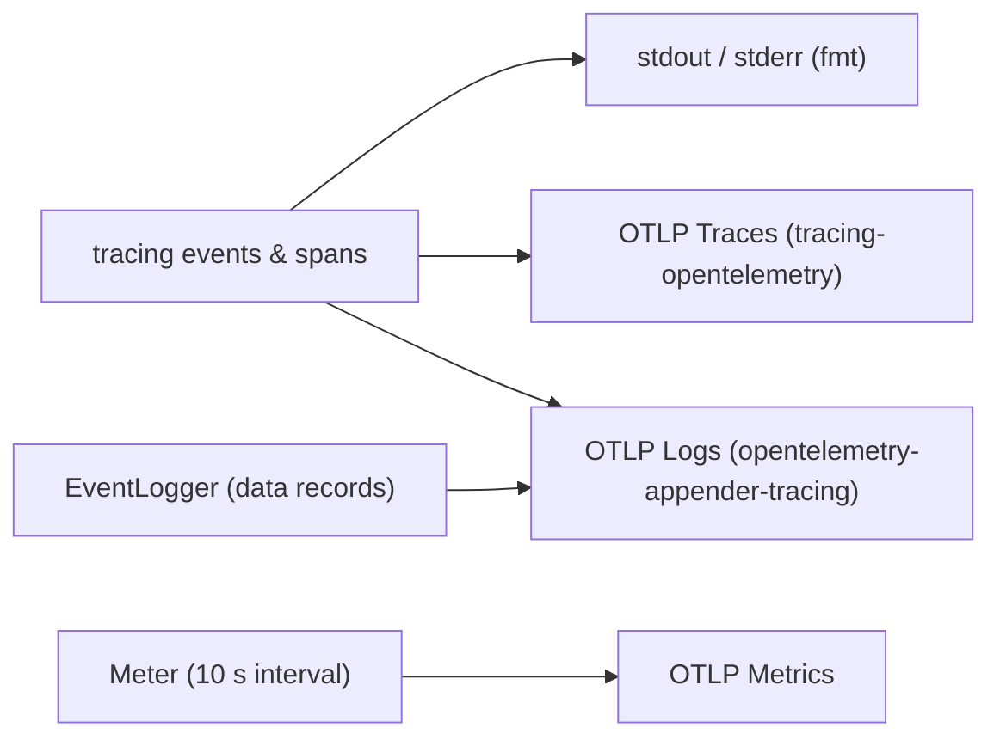

# `telemetry-otlp` Architecture

## Status
Living document. Update alongside any change to design intent, module boundaries, runtime flow, or invariants.

## Scope
Single `init` entry point that installs the global `tracing` subscriber and OpenTelemetry exporters for workspace binaries. Each crate decides what to record in spans and metrics.

## Outputs & Filtering

| Output | Filter env var | Content |
| --- | --- | --- |
| stdout (or stderr via `LogOutput::Stderr`) | `<SERVICE>_STDOUT_FILTER` | `tracing_subscriber::fmt` text with line numbers |
| OTLP traces | `<SERVICE>_OTEL_FILTER` | Spans only (`tracing-opentelemetry`) |
| OTLP logs | `<SERVICE>_LOG_FILTER` | Events (`opentelemetry-appender-tracing`) |

- **`<SERVICE>` naming**: Uppercase `TelemetryConfig::service_name` with `-` → `_` (e.g., `relay` → `RELAY_STDOUT_FILTER`).
- **Filter fallback**: Each filter falls back to `RUST_LOG`. Missing targets from `default_directives` and `telemetry_otlp=info` are appended automatically, so `RUST_LOG=quinn=debug` still logs `relay=info`.
- **Log-span correlation**: `tracing-opentelemetry` activates each span's OTel context on enter, so inner logs automatically carry its trace and span IDs.

### OTLP Activation & Env Vars
OTLP exporters start **only** when `OTEL_EXPORTER_OTLP_ENDPOINT` is set and `OTEL_SDK_DISABLED` is not (avoiding OTel's default `localhost:4317` export when no collector exists).

- `OTEL_EXPORTER_OTLP_PROTOCOL`: `grpc` (default) or `http/protobuf`
- `OTEL_EXPORTER_OTLP_HEADERS`: passed through by `opentelemetry-otlp`
- `OTEL_SERVICE_NAME`: overrides `service.name` (resource carries `service.name`, `service.version`, and caller `resource_attributes`)
- When OTLP is active, `init` also installs the global W3C Trace Context propagator.

## Event Records (`EventLogger`)
`TelemetryGuard::event_logger` returns `Some(EventLogger)` when OTLP is enabled, for structured high-frequency data (such as 1 Hz relay snapshots):
- Sent straight to the OTLP log exporter, bypassing `tracing` filters and stdout.
- Sets `EventName` and body to the event name, severity to `INFO`, and payload as one string attribute (keeping JSON out of the body prevents ClickStack from splitting every JSON key into duplicate attributes).

## Metrics (`Meter`)
`TelemetryGuard::meter` returns `Some(Meter)` when OTLP is enabled. Export interval defaults to `OTEL_METRIC_EXPORT_INTERVAL` = **10 s** (instead of OTel's 60 s) so 1-hour HyperDX charts have sufficient resolution. The relay exports process gauges through `ProcessGauges` ([`observability/architecture.md`](../observability/architecture.md)).

## Trace Context

| Helper | Carrier | Role |
| --- | --- | --- |
| `inject_trace_context` / `current_trace_headers` | `http::HeaderMap` | Injects W3C `traceparent` **and** `x-original-traceparent` on outgoing HTTP calls (including `auth_token::VtsClient`). |
| `continue_trace_from` | `http::HeaderMap` | Attaches a server span to `x-original-traceparent`, falling back to `traceparent`. |
| `current_traceparent` / `continue_trace_from_traceparent` | `String` | Non-HTTP propagation (e.g., relay ↔ `moqt` `TRACE_CONTEXT`). |

- **Why `x-original-traceparent`**: Cloud Run's front end rewrites `traceparent` to a Cloud-Trace-only parent span, breaking parent links in HyperDX. `x-original-traceparent` passes through untouched.
- **No-op when disabled**: With OTLP off, the global propagator is a no-op and all trace-context helpers do nothing.

## Lifecycle
`init` fails if a subscriber is already installed or the OTLP protocol is unknown. Hold the returned `TelemetryGuard` for the lifetime of `main`: dropping it shuts down providers and flushes queued batches.

## Test Subscribers (`testing` feature)
Tests capturing spans/events call `testing::set_default` instead of `tracing::subscriber::set_default`. With a single dispatcher, `tracing-core` caches callsite interest from whichever thread runs first, so concurrent non-capturing tests can cache `never`. `testing::set_default` keeps a second idle dispatcher alive so interest is combined across dispatchers. (`moqt` keeps a local copy in `test_support` to avoid compiling OpenTelemetry in `cargo test -p moqt`.)

## Dependencies
- OpenTelemetry crates: [opentelemetry.md](opentelemetry.md)
- `http` (`HeaderMap`): [http.md](http.md)
