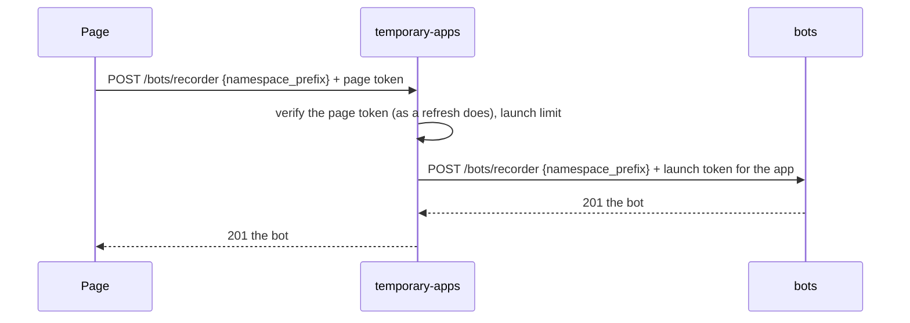

# `temporary-apps` Architecture

## Status
Living document. Update this file in the same change whenever the design intent,
module boundaries, runtime flow, or invariants described here change.

## Scope
`temporary-apps` hands anyone the token of a new temporary app, and a new token
for an app whose token has not expired. A temporary app has no registry entry:
its `appId` carries `auth_token::TEMPORARY_APP_ID_PREFIX`, and every token of
every temporary app is signed with one secret that the VTS verifies them with
(see the VTS architecture). The examples use these apps so that a demo runs
under a namespace root only the people its link reaches know, rather than the
public `anon` root.

There are no accounts. Who may join an app is whoever holds one of its
tokens; a token expires an hour after it is signed, which is the only way an
app is revoked.

## Modules

| Module | Responsibility |
| --- | --- |
| `issuer.rs` | `TemporaryApps`: `issue` signs `Claims::issued` for a new `temp-<32 hex>` app with `publish` and `subscribe` `""` and a one-hour lifetime; `refresh` verifies the token with the secret, requires a temporary `appId` and an `exp` after now, and signs a new hour for the same app. A failed refresh is a `RefreshError`. `verify` is the check `refresh` makes, and `sign_launch` signs the one-minute launch token `bots` takes from an app server, with `bots` `""` and no `publish` or `subscribe`. |
| `bot_proxy.rs` | `BotProxy`: the bot types a temporary app may reach, the launch limit per client address, and the call to `bots` with a launch token. |
| `rate_limit.rs` | `RateLimit`: fixed windows per client address, counted in this process. |
| `server.rs` | `TemporaryAppsServer`: serves HTTP/1 through `http_server::HttpServer`. Routes `POST /tokens` (rate limited), `POST /tokens/refresh`, the app server routes of `bots` (`POST`/`GET /bots/{type}`, `GET`/`DELETE /bots/{type}/{id}`), `GET /healthz` and `OPTIONS` (CORS preflight); every response allows any origin. Finds the client address in `X-Forwarded-For` from the number of trusted proxies in front (`TEMPORARY_APPS_TRUSTED_PROXY_HOPS`). |
| `main.rs` | Reads `TEMPORARY_APPS_SECRET`, `TEMPORARY_APPS_TRUSTED_PROXY_HOPS`, `TEMPORARY_APPS_BOTS_URL`, `TEMPORARY_APPS_BOT_TYPES` and `PORT`, and serves until terminated. |

## Bots

The service is the app server of every temporary app
(docs/architecture/bots/architecture.md "Temporary apps"): a page that wants
a bot in its room calls the `/bots` routes here with its own token, and the
call goes on to `bots` with a launch token for the page's app.

- The app is the page token's `appId`; `bots` refuses a room outside it,
  since the launch token's `bots` claim covers that app only.
- A type outside `TEMPORARY_APPS_BOT_TYPES`, and the routes the bots
  themselves call (`/token`, `/heartbeat`), are `404` here.
- `POST` counts against 10 calls per client address per hour, in fixed windows
  of this process like `POST /tokens`.
- Without `TEMPORARY_APPS_BOTS_URL` every `/bots` route is `404`.

## Invariants

- The service keeps no state besides the rate limit counts: an app exists only
  as its tokens, so any number of instances serve the same apps.
- An expired token cannot be refreshed, so a link holding it stops working an
  hour after it was signed even while the app lives on through refreshes made
  by the pages still using it.
- Only `POST /tokens` is rate limited. A refresh needs a valid token, and
  refreshing does not create an app.
- The client address is the `X-Forwarded-For` entry that the outermost of the
  trusted proxies (`TEMPORARY_APPS_TRUSTED_PROXY_HOPS`) appended; entries the client wrote before it are
  ignored, so a client cannot pose as another address. Without the header, or
  with `0` hops, it is the peer address.
- With several instances, each counts on its own, so a client may get up to
  the limit from every instance.

## Operational notes

- `temporary token issued` / `temporary token refreshed` are logged at INFO
  with the `app_id`, as is `bot request forwarded` with its `bot_type`;
  refusals at INFO with `error`. A signing failure is an
  ERROR. Tokens never reach logs or spans.
- Every request runs in a `temporary_apps.request` span that continues the
  caller's trace and records the `app_id` it answered for.
- The Docker image (`services/temporary-apps/Dockerfile`) is the same
  `cargo-chef` build onto `distroless/cc` as the VTS.
