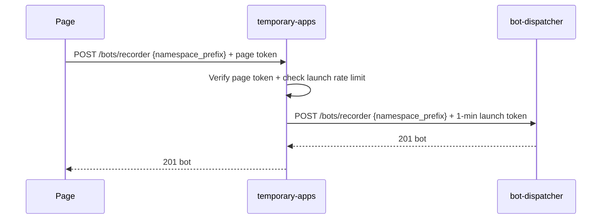

# `temporary-apps` Architecture

## Status
Living document. Update alongside any change to design intent, module boundaries, runtime flow, or invariants.

## Scope
Issues and refreshes tokens for temporary apps so demos run under an unguessable namespace root instead of public `anon`.

Temporary apps have no registry entry and no accounts:
- Every `appId` uses `auth_token::TEMPORARY_APP_ID_PREFIX` (`temp-<32 hex>`).
- All temporary tokens are signed with one shared secret that VTS verifies ([`vts/architecture.md`](../vts/architecture.md)).
- Anyone holding a valid token can join; expiry (1 hour) is the only revocation mechanism.

## Modules

| Module | Key types | Responsibility |
| --- | --- | --- |
| `issuer.rs` | `TemporaryApps`, `RefreshError` | `issue` mints a 1-hour token (`publish`/`subscribe` = `""`); `refresh` validates via `verify` (signature, temporary `appId`, unexpired `exp`) and mints another hour; `sign_launch` mints a 1-minute `bot-dispatcher` launch token (`bots` = `""`, no `publish`/`subscribe`). |
| `bot_proxy.rs` | `BotProxy` | Enforces allowed bot types and per-IP launch limits, then forwards requests to `bot-dispatcher` with a launch token. |
| `rate_limit.rs` | `RateLimit` | In-process fixed-window counters per client IP. |
| `server.rs` | `TemporaryAppsServer` | HTTP/1 server via `http_server::HttpServer` with wildcard CORS (`*`). |
| `main.rs` | — | Reads config env vars and serves until shutdown. |

### Routes & Configuration

| Route | Auth / Rate limit | Purpose |
| --- | --- | --- |
| `POST /tokens` | Rate limited per IP | Mint a new temporary app token |
| `POST /tokens/refresh` | Valid unexpired temp token | Extend an existing temporary app by 1 hour |
| `POST`/`GET /bots/{type}`, `GET`/`DELETE /bots/{type}/{id}` | Valid temp token (`POST` limited to 10/IP/hour) | Proxy to `bot-dispatcher` as the app server |
| `GET /healthz`, `OPTIONS` | None | Health check and CORS preflight |

Env vars: `TEMPORARY_APPS_SECRET`, `TEMPORARY_APPS_TRUSTED_PROXY_HOPS`, `TEMPORARY_APPS_BOT_DISPATCHER_URL`, `TEMPORARY_APPS_BOT_TYPES`, `PORT`.

## Bots
`temporary-apps` acts as the app server for all temporary apps ([`bot-dispatcher/architecture.md`](../bot-dispatcher/architecture.md) "Temporary apps"): pages call `/bots` with their page token, and this service forwards to `bot-dispatcher` with a short-lived launch token scoped to the page's `appId`.

- **App scoping**: `bot-dispatcher` rejects rooms outside the page token's `appId` because the launch token's `bots` claim covers only that app.
- **`stay_when_empty` rejected**: `POST /bots/{type}` with `stay_when_empty: true` returns `403 forbidden` without calling `bot-dispatcher` (`false` is forwarded).
- **Hidden routes**: Bot types outside `TEMPORARY_APPS_BOT_TYPES`, bot-internal routes (`/token`, `/heartbeat`), and all `/bots` routes when `TEMPORARY_APPS_BOT_DISPATCHER_URL` is unset return `404`.

## Invariants

- **Stateless apps**: Only rate-limit counters live in memory; any instance serves any temporary app.
- **No refresh after expiry**: An expired link stops working after 1 hour even if active pages keep refreshing newer tokens for the same app.
- **Selective rate limits**: Only `POST /tokens` and `POST /bots/{type}` have separate per-IP counters; refreshes require a valid token and create no new app.
- **Proxy-safe client IP**: Client IP comes from the `X-Forwarded-For` entry added by the outermost trusted proxy (`TEMPORARY_APPS_TRUSTED_PROXY_HOPS`), ignoring client-supplied prefixes; falls back to peer address when absent or `0`.
- **Per-instance limits**: Multiple instances count independently, so effective limits scale with instance count.

## Operational Notes

- **Logging**: `temporary token issued`, `temporary token refreshed` (`app_id`), `bot request forwarded` (`bot_type`), and refusals (`error`) log at `INFO`; signing failures at `ERROR`. Tokens never appear in logs or spans.
- **Tracing**: Every request runs in `temporary_apps.request`, continuing the caller's trace and recording `app_id`.
- **Packaging**: `services/temporary-apps/Dockerfile` uses the same `cargo-chef` → `distroless/cc` build as VTS.
