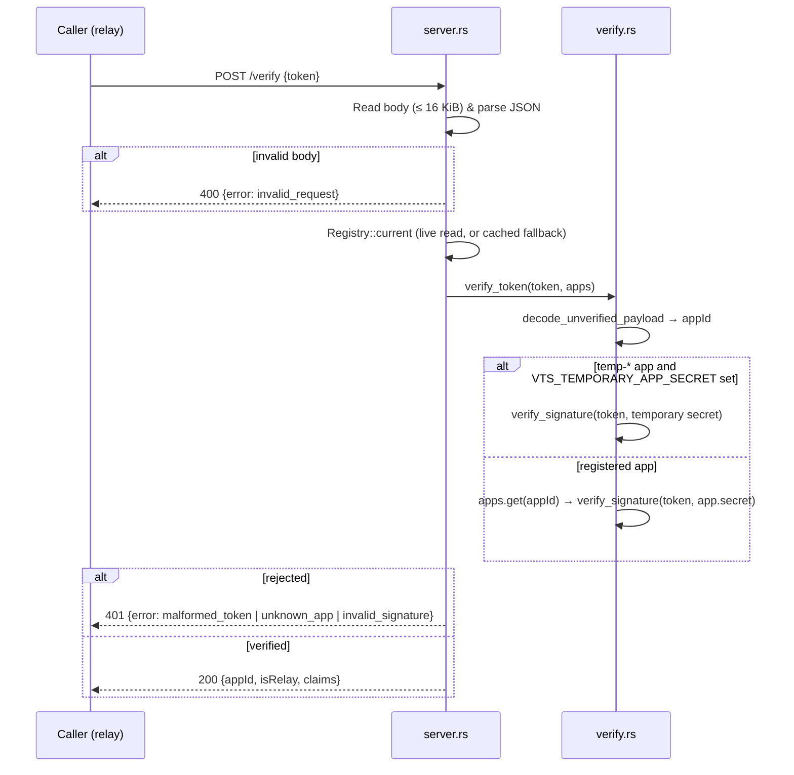

# `vts` Architecture

## Status
Living document. Update alongside any change to design intent, module boundaries, runtime flow, or invariants.

## Scope
Verify Token Service (VTS): an HTTP service called once per session by the relay (and other services) to verify a client JWT's HS256 signature against a registered or temporary app secret, and to report whether the app is a relay.

- **Signature check only**: Token lifetimes (`iat`, `exp`, max TTL, clock leeway) and `publish`/`subscribe` semantics stay in the caller (e.g., `services/relay/src/modules/auth/`), so one clock and policy govern both acceptance and expiry.
- **Temporary apps**: Any `appId` prefixed with `auth_token::TEMPORARY_APP_ID_PREFIX` (`temp-`) is verified with one shared secret (`VTS_TEMPORARY_APP_SECRET`) instead of a registry entry.
- **Signing lives elsewhere**: Token signing is in `auth-token` / `console` / `temporary-apps`.

## Modules

| Module | Key types | Responsibility |
| --- | --- | --- |
| `registry.rs` | `Registry` | Loads `app_registry::Apps` via `crates/app-registry` on every `current()` call, caching the last good snapshot as a read-failure fallback (with a `WARN` log). `Registry::load` fails hard on initial startup failure. |
| `verify.rs` | `verify_token`, `VerifiedToken`, `RejectReason` | Decodes unverified `appId`, selects temporary or registered secret, calls `auth_token::verify_signature`, and maps `SignatureError` to `malformed_token` or `invalid_signature`. |
| `server.rs` | `VtsServer`, `Secrets` | Serves HTTP/1 via `http_server::HttpServer`: `GET /healthz`, `POST /verify`; everything else returns `404`. |
| `main.rs` | — | Reads `VTS_APPS_FILE` or `VTS_REGISTRY_BUCKET` (mutually exclusive) and `VTS_TEMPORARY_APP_SECRET`, loads `Registry`, and binds `0.0.0.0:<port>`. |

## Request Flow

## Invariants

**Token & claim rules**
- **Pass-through claims**: `200` returns the signed payload unchanged in `claims`; VTS never modifies or interprets claims.
- **Temporary app precedence**: Temporary apps are never relays. When `VTS_TEMPORARY_APP_SECRET` is set, it shadows any registered `temp-` app; when unset, `temp-` IDs fall through to registry lookup (normally `unknown_app`).
- **Secret containment**: Signing secrets live only in the registry and `VTS_TEMPORARY_APP_SECRET`; the relay never receives them.

**Deterministic rejection order**
1. `malformed_token` — not 3 JWT segments, non-object payload, or missing/empty string `appId`.
2. `unknown_app` — `appId` not found.
3. Signature check — `malformed_token` for non-object header, missing string `alg`, or invalid base64url signature; `invalid_signature` for non-`HS256` `alg` or MAC mismatch.

**Registry & fallback**
- **Fresh registry on valid requests**: Every valid `/verify` reads the registry so rotated secrets and deleted apps take effect immediately; invalid bodies fail before reading.
- **Fallback semantics**: During a registry outage, `/verify` falls back to the last loaded snapshot (revocations wait until reads recover), while new instances refuse to start. Overlapping reads overwrite the fallback in completion order.

## Operational Notes

- **Logging**: `telemetry-otlp` logs `verify ok` / `verify rejected` at `INFO` and HTTP connection errors at `DEBUG`. Filters: `VTS_STDOUT_FILTER`, `VTS_OTEL_FILTER`, `VTS_LOG_FILTER` (each falling back to `RUST_LOG`).
- **Tracing**: Requests run in `vts.request`, continuing `x-original-traceparent` (else `traceparent`) under the relay's `relay.vts.verify` span. Records `outcome` (`verified` + `app_id`/`is_relay`, or rejection reason); never records tokens or secrets.
- **Packaging**: `services/vts/Dockerfile` uses `cargo-chef` → `distroless/cc` (same base as relay).
