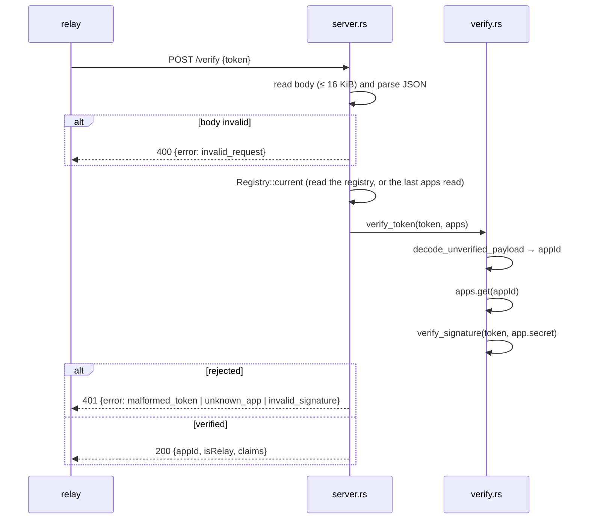

# `vts` Architecture

## Status
Living document. Update this file in the same change whenever the design intent,
module boundaries, runtime flow, or invariants described here change.

## Scope
The `vts` crate is the Verify Token Service: an HTTP service the relay calls
once per session to check that a client's JWT was signed with the secret of a
registered app, and whether that app is a relay. Signing tokens is
`auth-token`'s CLI, not the VTS's.

The service deliberately answers only the signature question. Token lifetime
(`iat`, `exp`, the maximum TTL, clock leeway) and the meaning of `publish` /
`subscribe` are the relay's policy (`crates/relay/src/modules/auth/`), so one
clock and one rule set govern both accepting a session and expiring it later.

## Modules

| Module | Responsibility |
| --- | --- |
| `registry.rs` | `Registry`: reads the apps through `app-registry` on every `current` call and keeps the last apps it read. A read that fails logs a warning and returns those last apps. `Registry::load` fails when the first read fails. |
| `verify.rs` | `verify_token`: `auth_token::decode_unverified_payload` → require string `appId` → look up the app → `auth_token::verify_signature` with that app's secret. Returns `VerifiedToken { app_id, is_relay, claims }` or a `RejectReason`; a `SignatureError` maps onto `malformed_token` or `invalid_signature`. |
| `server.rs` | `VtsServer`: owns the accept-loop `JoinHandle`; one `tokio::spawn` per connection running hyper HTTP/1. Routes `GET /healthz` and `POST /verify`; everything else is 404. |
| `main.rs` | Picks the registry location (`VTS_APPS_FILE` or `VTS_REGISTRY_BUCKET`, not both), loads the `Registry`, binds `0.0.0.0:<port>` and serves until the process is terminated. A registry that cannot be loaded at startup stops the process. |

The registered apps are `app_registry::Apps`; parsing, validation and storage live in `crates/app-registry`.

## Request flow

## Invariants

- `claims` in the 200 response is the signed payload as-is. The VTS never
  adds, removes or interprets claims; the relay's `SignedToken` reads them.
- Rejections are reported in the order they are detected: `malformed_token`
  (not three segments, payload not a JSON object, or no non-empty string
  `appId`), then `unknown_app`, then `invalid_signature`. A header whose
  `alg` is anything other than `HS256` is `invalid_signature`, matching the
  previous Node.js implementation built on `jose`, so the relay's
  `AuthenticationError` mapping is unchanged.
- Signing secrets exist only in the registry. The relay never receives them.
- Every `/verify` with a valid body reads the registry, so a rotated secret or
  a deleted app is refused from the next verification on. A request with an
  invalid body is answered before the registry is read.
- While the registry cannot be read, `/verify` keeps verifying with the apps
  last read, so revocations made during that time take effect only once it can
  be read again. A new instance that cannot read the registry does not start.
- The apps last read are replaced by whichever read finishes last; two reads
  that overlap may leave the one that started earlier. Those apps are used
  only while the registry cannot be read.

## Operational notes

- Logging goes through `tracing`, set up by `crates/telemetry`: `verify ok` /
  `verify rejected` at INFO, per-connection HTTP errors at DEBUG.
  `VTS_STDOUT_FILTER`, `VTS_OTEL_FILTER` and `VTS_LOG_FILTER` filter, each
  falling back to `RUST_LOG`.
- The Docker image (`crates/vts/Dockerfile`) is a `cargo-chef` build onto
  `distroless/cc`, the same base as the relay, and ships `vts`.
