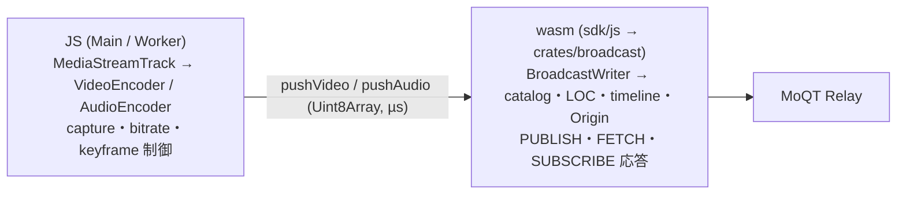

# ブラウザ SDK 設計

## ステータス
実装済み。配布は GitHub Release の tarball で行い、npm 公開は含まない（「[配布](#配布)」）。パッケージ構成・公開 API・不変条件の変更時にこのファイルも更新する。

## 目標
Web 開発者が npm パッケージ1つで、MoQ のメディア PubSub（接続・配信・再生）と型付き track 単位 PubSub（チャット・テレメトリ・制御）を数十行で書けるようにする。`examples/browser` はすべてこの SDK の上で動く。

| 項目 | API |
| --- | --- |
| 接続 | `MoqSession.connect(url, { token, versions })`（`versions` 省略時は `draft-18`, `draft-14` の順） |
| 再生 | `moq-wasm/media` の `new LivePlayer({ container, callbacks })` / `start(session, namespace)` |
| 配信 | `moq-wasm/media` の `createBroadcast(session, namespace)` / `addSource(name, input)` |
| track 単位 PubSub | `MoqSession` の `subscribe` / `fetch` / `publishTrack`（handle と async iteration） |
| パッケージ | `sdk/js/js` の `moq-wasm`（examples は `source` condition で TS を直接参照。`npm run build` が `dist`/`types` を生成し、CI が新規 Vite プロジェクトで `npm pack` tarball を検証） |

**目次:** [利用コード](#利用コード) · [パッケージ構成](#パッケージ構成) · [配信 (`crates/broadcast`)](#配信を-cratesbroadcast-に寄せる) · [会議再生 (`LivePlayer`)](#会議の再生を-liveplayer-に載せる) · [source 単位の送受信](#相手ごとに再生しsource-を名前で扱う) · [`PhoneCall`](#電話をつなぐ-phonecall) · [録画再生](#録画を-liveplayer-で再生する) · [`<moq-player>`](#moq-player) · [core API](#core-api) · [bundler/決定事項](#bundler-互換バージョニング決定事項) · [配布](#配布)

## 利用コード

```ts
// 接続（token に関数を渡すと接続・GOAWAY 移行・再接続のたびに呼ばれる）
import { MoqSession } from 'moq-wasm'
const session = await MoqSession.connect('https://relay.example.com:4433', {
  token: () => fetchTokenFromMyBackend(),
})
session.closed.then((info) => console.log('session closed', info))

// カメラ・マイク配信
import { createBroadcast } from 'moq-wasm/media'
const broadcast = await createBroadcast(session, ['room-1', 'alice'])
const camera = await broadcast.addSource('camera', {
  label: 'Camera',
  video: true,
  audio: true,
  main: { height: 720, bitrate: 2_500_000 },
  renditions: [{ name: '360p', label: '360p', width: 640, height: 360, bitrate: 600_000 }],
})
await camera.setVideo(screenStream.getVideoTracks()[0])
await camera.setMuted('audio', true)
await broadcast.close()

// namespace 再生（自前 UI の場合は PlayerControls を省き onStateChange で描画）
import { LivePlayer, PlayerControls } from 'moq-wasm/media'
import 'moq-wasm/media/player.css'
import 'moq-wasm/media/controls.css'
const container = document.querySelector<HTMLElement>('#view')!
const player = new LivePlayer({
  container,
  callbacks: { onStateChange: () => {}, onLiveFrame: () => {}, onLog: () => {} },
})
new PlayerControls(container, player, () => {})
await player.start(session, ['room-1', 'alice'])

// track 単位 PubSub
const chat = await session.publishTrack(['room-1', 'alice'], 'chat')
await chat.writeGroup(new TextEncoder().encode('hello'))
for await (const obj of await session.subscribe(['room-1', 'alice'], 'chat')) {
  console.log(obj.groupId, new TextDecoder().decode(obj.objectPayload))
}
for await (const ev of await session.watchNamespaces(['room-1'])) {
  if (ev.kind === 'announced') void player.start(session, ev.namespace)
}
```

## パッケージ構成

1つの npm パッケージに subpath exports を置く（Rust: `sdk/js`、TS: `sdk/js/js/`、ビルド: `wasm-pack --target web` + `tsc` + Vite app build）。

| Subpath | 公開内容 |
| --- | --- |
| `moq-wasm` | core: `init`, `MoqSession`, `MoqSubscription`, `MoqGroup`, `MoqFetch`, `MoqNamespaceWatch`, `TrackWriter`, `RequestError`, 型 |
| `moq-wasm/media` | `createBroadcast`, `watchBroadcasts`, `RemoteBroadcast`, `BroadcastCatalog`, `botNamespace`, `botTypeOf`, `subscribeTranscript`, `PhoneCall`, `LivePlayer`, `PlaybackGroup`, `PlayerControls`, `parseCatalog`, `Mp4Broadcast` |
| `moq-wasm/media/{player,controls}.css` | プレイヤー / コントロール用スタイル |
| `moq-wasm/recording` | `openRecording`, `Recording`, `RecorderError`（recorder HTTP API のみ。wasm/media 非依存） |
| `moq-wasm/element` | `<moq-player>`（import 時に `customElements.define` を実行） |

**1パッケージにする理由**: `core` と `media` は単一の wasm インスタンスと `Session` を共有する。分割するとバージョンずれで wasm インスタンスが2重生成され、同時初期化でヒープが壊れる。subpath exports なら tree shaking で視聴専用・データ専用のバンドルを小さく保てる。

## 配信を `crates/broadcast` に寄せる



JS にはブラウザ固有処理（capture・encoder 設定・keyframe 要求・bitrate 制御）のみ残し、MSF・プロトコル処理（catalog 組み立て `build_catalog`・LOC/CMAF・media timeline・壁時計起算の group id・`moqt::Origin` 60秒キャッシュ・GOAWAY 移行・30秒周期 catalog 再送）はすべて wasm (`crates/broadcast`) に集約する。

### 下層 (`broadcast` / wasm) の拡張点

**セッション・トラック管理**
- **session 共有**: `RelayConnection::with_client_session` により既存 `moqt::Session` 上で配信と再生を共有（`Mp4Broadcast` も 2 本目の接続を開かない）。
- **rendition (CMSF switching set)**: 全 rendition へ同一 `VideoFrame` を渡し同フレームで keyframe 化。`RenditionTrack` + `RenditionKeyframes::SameFrames` により順不同出力でも同一時刻の group id を揃える。
- **track ライフサイクル**: `Broadcast::remove_track` が catalog 更新と `PUBLISH_DONE` を出し、ミュート・ソース差し替え・画面共有終了に対応。
- **catalog 独自フィールド見送り**: parser は MSF §5 に従い未知フィールドを無視。producer 側は用途が出るまで独自フィールドを追加せず、MSF の `label` / `role` を使う。

**メディア形式・コーデック**
- **Annex-B parameter set**: `MediaBroadcast` は最初の keyframe から `mediapack::h264`（`ParameterSetTracker` / `AvcDecoderConfigurationRecord::from_parameter_sets`）で `VideoConfig::Avc` を生成し、解像度変化時に作り直す。
- **Audio Level**: JS が capture サンプルから計算し `pushAudio` に渡す → `broadcast` が LOC Audio Level property (draft-ietf-moq-loc-04) に書く。
- **多コーデック**: 映像 H.264/H.265/VP8/VP9/AV1、音声 AAC (`decoderConfig.description` → `AudioConfig::Aac`)/Opus/A-law/MP3 に対応。VP9 level は画面サイズに収まる最小値で catalog と `vpcC` を一致させる。
- **CMAF opt-in**: ブラウザ配信は既定で CMAF 兄弟 track を作らない。`addSource` の `cmaf: true` で映像と rendition のみ生成（Opus 音声不可）。LOC と encoder を共有。

### 映像 encoder ウォームアップ (`EncoderWarmUp`)
macOS Chrome (Chrome 156 確認) では最初の `VideoEncoder` 起動に数秒かかり、滞留した古いフレームがまとめて live 配信され受信ジッターバッファーを膨らませる。映像 worker (`media/internal/encoders/videoEncoder.ts`) は encoder 生成ごとに先頭1フレームを keyframe として encode し `flush()` 完了まで出力を破棄（間の入力は `frameDropped` 計上）、破棄出力の `decoderConfig` を最初の live 出力へ引き継ぐ。

### Safari 対応 (Safari 27.0.1 確認)
- **WebTransport datagram**: wasm が `datagrams.createWritable()` を優先試行。
- **映像 capture**: page に `MediaStreamTrackProcessor` が無いため track clone を worker へ transfer して読み、停止時は worker 側で clone を stop/close（`terminate` だけでは残る）。
- **音声 capture**: AudioWorklet で 10 ms 単位の PCM を取得し `MessageChannel` で encoder worker へ送って `AudioData` 化（`pcmCapture.ts`、10 ms は `CaptureTimestamps` 間隔に一致）。
- **encoder / 再生 / テスト**: H.264 Annex-B・Opus encode はそのまま使用。再生は `MediaStreamTrackGenerator` 不在のため canvas sink。Playwright WebKit は WebTransport 非対応のため実機確認。

### `MediaBroadcast` とデータ専用 track
`MediaBroadcast` は `addSource` ごとに `broadcast::MediaSource`（Python SDK と共有）を作り、track を `<name>` / `<name>_audio` として単一 catalog に載せる。チャット等の非メディア配信は `session.publishTrack` で直接 `Origin` に書く（catalog 掲載には `createBroadcast(..., { offerChat: true })`）。

## 会議の再生を `LivePlayer` に載せる

メンバーの source ごとに `LivePlayer` を作り、内部部品 (`LocLive` 等) は公開しない。draft-14 §9.7 が同一 session での重複 `SUBSCRIBE` を禁じるため、1 broadcast の catalog を1度だけ購読し再購読・`PUBLISH_DONE` を管理する `BroadcastCatalog` を `LivePlayer.start(session, namespace, catalog)` で共有する（省略時は player が自前で生成・クローズ）。

### `LivePlayer` の会議向け機能

| 機能 | API / 仕様 | 目的 |
| --- | --- | --- |
| source 指定 | `LivePlayerOptions.source` (`{ video, audio? }`)。rendition は `altGroup` (§5.2.13) から発見（番号に意味が無い `renderGroup` は使わない） | カメラと画面共有を別 player 化。映像ミュート中も音声継続 |
| 表示高さ上限 ABR | container の CSS px 高さで ladder を上限カット（`devicePixelRatio` 不乗算） | 小さいタイルは低 rendition を受信 |
| Audio Level | `onAudioLevel?(level: AudioLevel)`（LOC §2.3.3.2） | 話者検出 (`dominantSpeaker.ts`) |
| 優先度 | 固定 Subscriber Priority: catalog `0`, text `16`, audio `32`, video `128`。映像間は `setVideoPriority(0..255)` で動的変更（`SUBSCRIBE_UPDATE`） | 下り輻輳時に小 track やピン留め映像がブロックされるのを防ぐ |
| `DELIVERY TIMEOUT` | `deliveryTimeoutMs`（既定 `2000`, `null` 無効、範囲外 `RangeError`）。映像・音声・media timeline・`addAudioTrack` に適用（catalog/字幕/`addTextTrack` 除外） | 遅れた Group を relay でリセットさせ送信バッファ詰まりを防ぐ |
| `Group Order` | `groupOrder`: `'ascending'`（既定） / `'descending'`（`SUBSCRIBE` 後の変更不可） | 遅延増大よりフレーム飛びを許容するライブ視聴 |

### keyframe の間隔と NEW_GROUP_REQUEST
- **配信側**: 既定 keyframe 間隔 30 s（`encoding.keyframeIntervalSeconds`、timestamp 基準で全 rendition 同期）。`onKeyframeRequest` で `DYNAMIC_GROUPS` (§12.6) を付け、`NEW_GROUP_REQUEST` (§10.2.13) で `forceKeyframe` を発行。`Origin` は現 group が 2 s または 60 object に達するまで要求を保留し最短長を保証する。
- **オンデマンド encode (`onDemandChange`)**: 映像・rendition・音声を Forward State 0 で `PUBLISH` (§10.10)。視聴者ゼロの rendition はフレームを捨て、再視聴時に全 rendition で keyframe 化（音声は encoder 再生成）。静止画面共有の再視聴時は page が clone から 1 フレーム読み直して渡す（`refreshFrame`、Safari 除外）。catalog と media timeline は常時 Forward State 1。
- **初回購読**: `subscribeGroupStart(ns, track, 60)` — Largest Object < 60 なら joining FETCH、≥ 60 なら `NEW_GROUP_REQUEST`（1 s 来なければ FETCH; draft-14 や非 dynamic は常に FETCH）。
- **切り替え・`goLive`・decode 異常**: rendition 切替・`goLive`・decoder の delta 破棄開始時（`keyFrameNeeded`、後続 group 未着時のみ）に `requestNewGroup` を1回送る。relay は新 group 開始まで重複転送を抑止する。

## 相手ごとに再生し、source を名前で扱う

```ts
const local = await createBroadcast(session, ['room', 'alice'], { onError: console.error })
const camera = await local.addSource('camera', { label: 'Camera', video: true, audio: true })
preview.srcObject = camera.stream

const remotes = await watchBroadcasts(session, ['room'], {
  filter: (ns) => botTypeOf(['room'], ns) === undefined,
  onAdd: (remote) => {
    const tile = newTile(remote.namespace)
    remote.listen({
      onSourceAdd: (view) => {
        tile.append(view.element)
        view.listen({ onChange: () => tile.render(view.name, view.state) })
      },
      onSourceRemove: (view) => tile.forget(view.name),
      onAudioLevel: (view, level) => tile.speaking(level),
    })
  },
  onRemove: (remote) => removeTile(remote),
})
```

### source 命名規則と catalog 解析
- **命名**: 映像 `<name>`、音声 `<name>_audio`、rendition `<name>_<rendition>`、CMAF/timeline は `_cmaf` / `_timeline`。表示名は MSF `label` (§5.2.11)。空名・`catalog`・`chat`・`_audio`/`_cmaf`/`_timeline` 末尾・重複名は reject。`broadcast` 既定の `video`/`audio` は source `video` として扱う。
- **`RemoteBroadcast` 解析順**: (1) CMAF/timeline 除外 → (2) 同一 `altGroup` を1 source に統合（最短の映像 track 名、無ければ音声 track 名）→ (3) 残りを `<name>_audio` → `<name>`、`audio` → `video`、その他は自身の名前に分類（先行登録された rendition `<name>_<r>` は音声側の `<name>` へ統合）→ (4) track が1本でも残る間は source を維持（カメラ OFF 時は `state.video = 'off'`）。

### 送る側: `createBroadcast` / `LocalSource`
- **`createBroadcast(session, ns, { offerChat?, eventTimelines?, onError? })`**: 即座に namespace を公開。`close()` は全 source の `PUBLISH_DONE` を送り session は閉じない。
- **`LocalSource`**: `setVideo`/`setAudio`（`false` で解放）、`setMuted`/`isMuted`（デバイス保持のまま送信停止。相手からは OFF と同一で catalog から抜ける）、`stream`（プレビュー用 `MediaStream`）、`stats()`（映像/rendition の kbps・fps・frameSize・drop/error、音声の直近1秒 `AudioData` 数・sampleRate・ch・RFC 6464 dBov 最小/平均）、`listen({ onTrackEnded, onEnded })`。音声 track の `mute`/`unmute`/`ended` は `readyState` 付きで `INFO` ログ出力。
- **入力 (`input`)**: `video`/`audio` は `true`/`MediaTrackConstraints`（両方指定時は1回の `getUserMedia`）、`MediaStreamTrack`（`stream` は糖衣）、`display`（`getDisplayMedia`）。SDK が取得した track のみ SDK が stop する。
- **encode 設定**: `encoding`（全 track: `codec`, `keyframeIntervalSeconds`, `hardwareAcceleration`, `latencyMode` 既定 `'realtime'`、`scalabilityMode: 'L1T1'` 固定）、`main`（`width`, `height`, `bitrate`, `framerate`）、`renditions`（`width`/`height` または `scaleResolutionDownBy`、`bitrate` 必須、`framerate`, `codec`）。`framerate` 指定時は `frameRateLimit.ts` が keyframe 以外を間引き catalog `framerate` を記載。`setVideoEncoding` で再構築。

### 受ける側: `watchBroadcasts` / `RemoteBroadcast`
- **`watchBroadcasts(session, prefix, { filter?, onBotChange?, onAdd, onRemove })`**: ハンドラを引数で受け取り取りこぼしを防止（例外は `reportError` で報告し監視は継続）。自 session の `createBroadcast` namespace は自動除外。`filter` は公開時のみ呼ばれ、withdraw 時は片付け（失敗時も）後に `onRemove`、再公開時は `onRemove` → `filter` 通過時のみ `onAdd`。`close()` は全 `RemoteBroadcast` を破棄（`onRemove`/`onBotChange` 呼ばず）。
- **`onBotChange(botType, present)`**: `botTypeOf(prefix, ns)` に一致する bot namespace の公開/撤回を通知（重複 `SUBSCRIBE_NAMESPACE` による `NAMESPACE_PREFIX_OVERLAP` を避けるため同一 watch から送出）。再生要否は `filter` と独立（自 session の bot は通知のみで再生しない）。
- **`RemoteBroadcast` / view**: `listen`（登録時に既存 source を再送）、`sources`、`catalog`、`dispose`。view は `name`, `label`, `element`, `state` (`{ video, audio, videoSize? }`), `setVolume`, `stats`, `setVideoEnabled`, `player`。
- **`view.element`**: `--moq-object-fit`（既定 `contain`）、`data-source`/`data-video`/`data-audio` 属性。`IntersectionObserver` で画面外の映像購読を自動停止（opt-out 可、手動 `setVideoEnabled(false)` は上書きしない）。同一タスク内の DOM 移動では再生停止しない。
- **音声出力・後始末**: ページが user gesture で resume した単一 `AudioContext` を `audioContext` option で渡す（`setSinkId` や close もページ管理）。`pagehide` 自動 close は不要（Chrome が WebTransport を自動で閉じる）。meeting は `createBroadcast` + `session.watchNamespaces` + `new RemoteBroadcast` に加え、`botTypeOf` と `subscribeTranscript` を使用する。

### room の bot と文字起こし

| API | 振る舞い |
| --- | --- |
| `botNamespace(room, botType)` | `bot-dispatcher` が起動した bot の namespace `[...room, 'bots', botType]` を返す |
| `botTypeOf(room, namespace)` | `[...room, 'bots', <type>]` なら `<type>`、それ以外は `undefined` |
| `subscribeTranscript(session, room, onRecords)` | `botNamespace(room, 'transcriber')` の `transcript` track（MSF event timeline）を `subscribeCurrentGroup` で購読し、変化ごとに `TranscriptRecord[]`（`{ startedAtMs, speaker, text, live }`、joining FETCH 履歴は `live: false`、壊れた object/record はスキップ）を通知。不在時は `RequestError` で reject（`onBotChange`/`botTypeOf` 検知後に呼ぶ）。返り値 `TranscriptSubscription` は `{ done, close() }` |

## 電話をつなぐ `PhoneCall`
SIP gateway（[`sip-gateway/architecture.md`](../sip-gateway/architecture.md)）とページを1対1で接続する。ページは発呼せず、アプリサーバから受け取った `call_id` / namespace で参加する。

```ts
const call = await PhoneCall.join(session, {
  call: ['app', 'room', 'phone', callId],
  local: ['app', 'room', 'alice', 'call', callId],
  audio: true,
  audioContext,
})
call.listen((state, reason) => {}) // dialing | ringing | answered | ended
await call.sendDtmf('1#')
await call.hangUp()
```

- **送信**: `createBroadcast(local)` にマイク source `microphone` を追加し、`session.publishTrack` で `control` track に1コマンド1 Group の JSON（`dtmf` / `hangup`）を書く。
- **受信**: `RemoteBroadcast(call)` で音声再生、`call` track を joining FETCH で購読（未公開時は 500 ms ごとにリトライ）。
- **終了**: `hangUp` は `control` に `hangup` を書いて停止（共有 session は閉じない）。`ended` 受信または `call` track 終了（`reason: 'gateway'`）でも停止。

## 録画を `LivePlayer` で再生する

録画は **MSF の VOD broadcast** として recorder が replay し、`LivePlayer` は catalog の `isLive: false` と media timeline（§7）だけを見てライブと統一的に再生する。recorder HTTP API は別 subpath `moq-wasm/recording` に分離し、ライブ専用バンドルへ入れない。

| 役割 | 振る舞い |
| --- | --- |
| publisher (`crates/broadcast`) | 全 source で `<video>_timeline` を出力（60 秒保持）。各 group 開始時（映像優先、無ければ音声）に entry を追加し ID 飛びを防ぐ |
| recorder (replay) | `renderGroup` ごとに `--max-video-height`（既定 720）以下最大を選択。LOC Timestamp / event `T` を録画開始からの media time（Timescale `1_000_000`, `M`）へ変換。保存データのみから決定的に VOD catalog（`isLive: false`, `isComplete: true`, `trackDuration`, `generatedAt` なし）・timeline（wallclock `0`）・話者別 `transcript` track（`eventType: io.skyway.research.moqt.transcript.v1`, `role: subtitle`, group 0 object 0）を生成（draft-14 §2.1 準拠で複数インスタンス重複に耐える） |
| `LivePlayer` / `PlaybackGroup` | `isLive: false` 時は media `SUBSCRIBE` せず FETCH 窓（4 group ずつ）で再生し終了時 `state.ended`。`PlaybackGroup` は巻き戻し・VOD 中のみ単一 `AudioContext` + capture/media time 位置で複数 player を同期し、範囲外 player は FETCH せず保持 |
| `moq-wasm/recording` | `openRecording(session, recorderUrl, id, { token })` が `POST /recordings/{id}/publish` 応答を保持し `{ prefix, startedAtMs }` を返す。`renew_after_seconds` ごとに新応答を開き 60 秒重ねてから旧応答を閉じる（relay の FETCH タイムアウト 10 s + 20 s を吸収）。想定外終了時は即再接続、失敗時 `closed` がエラー解決 |

`examples/browser/examples/recording-player` は `openRecording` + `watchNamespaces` + 参加者別 `LivePlayer` + `PlaybackGroup` で再生し、chat / transcript は `eventType` (§5.2.6) から識別して `SUBSCRIBE_OK` の Largest Location までを1回の FETCH で読む。MP4 録画の replay・v1 manifest・カメラ/画面共有専用独自フィールドは範囲外。

## `<moq-player>`
`moq-wasm/element` が登録する Custom Element（Shadow DOM 不使用、要素自体を container とし CSS はページが import）。

```html
<moq-player src="https://relay.example/moq" namespace="room/alice" token="…" controls></moq-player>
```

- **属性/プロパティ**: `src`（または既存 `session` プロパティ。渡した session は閉じない）、`namespace`（`/` 区切り）、`token`（属性は文字列、プロパティは関数可）、`controls`（着脱しても接続維持）、`packaging`（`setPackaging` で動的変更）、`tracks`。接続属性変更時は再生成（開始中の変更は集約）、DOM 離脱で `dispose` と自前 session の close。
- **操作/イベント**: `player` プロパティで `LivePlayer` を取得。`statechange` / `liveframe` / `error` (`ErrorEvent`) を発火。`deliveryObserver` 等が必要な場合は `LivePlayer` を直接使用。

## core API

`moqt::Session` を handle 型（`MoqSession`, `MoqSubscription`, `MoqGroup`, `MoqFetch`, `MoqNamespaceWatch`, `TrackWriter`）で包み、request id・track alias・subgroup id を公開しない。wasm 側 (`sdk/js/src/session.rs`) は `moqt::client`（[`moqt/architecture.md`](../moqt/architecture.md)「`client` — the client session」）の薄い `wasm_bindgen` ラッパ。

- **エラーとデータ**: 失敗リクエストは draft-14 コード付き `RequestError`。受信は `AsyncIterable<ReceivedObject>` / `groups(): AsyncIterable<MoqGroup>` で背圧管理。境界型は `Uint8Array` と `bigint`。`close()` は `"closed by the application"` で即座に返る。
- **認証トークン**: 関数指定時は初回接続・GOAWAY 移行・再接続の `CLIENT_SETUP` 直前に呼ぶ（relay は transport 確立後 10 秒でタイムアウト）。仕組みは `moqt` の `ClientConfig::authorization_token` 側にある。
- **再接続**: GOAWAY なし切断でも `Session` が同一 URL へ再接続（[`moqt/session-migration.md`](../moqt/session-migration.md)）。0.5 s → 最大 10 s の指数バックオフで最大 60 s 試行（SETUP 認証エラーはトークン再取得して1回のみ再試行）。handle・`Origin` キャッシュは維持され、諦めたときのみ `session.closed` が解決する。

### ログ・スパン・Client Telemetry (`init`)
- `init({ wasmUrl?, onLog?, logLevel?, onSpan?, telemetry? })`: 初回呼び出しの option のみ有効（single-flight）。`onLog` は `logLevel`（既定 `'warn'`）以上、`onSpan` は閉じた `INFO` 以上の span（`crates/telemetry-report`）を第2引数に session トークン付きで渡す（`SessionScope` + `set_spawn_wrapper` でタスクへ伝播）。peer リクエスト応答 span は `continue_trace_from_traceparent` で親トレースへ接続。
- `init({ telemetry: { url, page, redact?, playerStats?, stats? } })`: `ClientTelemetry` が 10 秒ごと・`pagehide`（`sendBeacon`）に `/api/client-telemetry` へトークン単位で送信（401 後はトークン無しで送信。wasm 読み込み失敗も送信するため TS sink を先に初期化）。
  - 稼働中の `LivePlayer` の `LiveStats`（`playerStats` 既定 `true`）と音声 `LocalBroadcast` の `AudioPublishStats` を自動収集。独自ログは `reportLog`、独自統計は `telemetry.stats`（`redact` 非適用）。
  - TS 層は `sdkLog`（worker は `workerLog` → `receiveWorkerLog`、UI 表示済みログは `forwardSdkLog`）で同じ sink へ流す。トークンは `bindLogToken` で内部紐付けし `MoqSession` API へは出さない。
  - 送信先を observability サーバにする理由（VPC・認証・レート制限）は [`observability/architecture.md`](../observability/architecture.md)「Client telemetry」参照。

## bundler 互換・バージョニング・決定事項

### bundler 互換
- ビルド済み JS を配布（実行時依存ゼロ、React は examples のみ）。
- **wasm / worker**: `new URL('...', import.meta.url)` で解決（Vite app build で出力。CDN 等は `init({ wasmUrl })`）。Safari AudioWorklet は文字列取り込み + Blob URL。
- **CSS**: JS からは import せず利用側が `player.css` / `controls.css` を読む。

### バージョニングと決定事項
- semver（他 crate と独立、1.0 未満は minor 破壊可。core API を先に 1.0 化し `media` の 1.0 未満ステータスは doc/README に明記）。対応 draft バージョンも公開契約として changelog に記載。
- **対応コーデック**: 映像 H.264 (`avc1.640028` 既定)・H.265（Hardware のみ、`hardwareAcceleration: 'no-preference'`）・VP8・VP9・AV1、音声 Opus（既定）・AAC（再生）。`encoding.codec` は短縮名または WebCodecs 文字列。
- **マルチコーデック `altGroup`**: 同一 `altGroup` に異コーデックの rendition を混在可能。player は `VideoDecoder.isConfigSupported` で再生可能 track を絞り同解像度は最低 bitrate を採用（切替時は先頭 keyframe で再 `configure`、level 差のみなら維持）。送信不可の rendition は `onError` 報告し除外。
- **対応ブラウザ**: Chrome、Edge、Safari。
- **UI**: `PlayerControls` の class 名と CSS 変数は公開範囲（DOM 構造は非公開）。
- **ページのコールバックの例外**: `moq-wasm/media` はページの関数（listener、`on*`、`filter`）を1つずつ `callPage`（`media/internal/callPage.ts`）経由で呼び、例外は `reportError` で報告して、SDK の状態と他 listener への通知はコールバックが返ったときと同じに進める。

## 配布

1.0 未満の間は npm レジストリに公開せず、`npm pack` のビルド済み tarball を GitHub Release に添付して配布する（利用者に Rust / wasm-pack 不要）。

```json
{
  "dependencies": {
    "moq-wasm": "https://github.com/<owner>/<repo>/releases/download/js-sdk-v0.1.0/moq-wasm-0.1.0.tgz"
  }
}
```

### リリース手順
1. PR 本文の `## リリースノート`（英文）をリリース PR で `CHANGELOG.md` へ集約し `package.json` の version を上げる（`.agents/skills/release-sdk/SKILL.md`）。並行 PR は `CHANGELOG.md` を直接編集しない。
2. `js-sdk-v<version>` タグを push する。
3. `.github/workflows/sdk-release.yml` がタグ・version・changelog を検証し、wasm/TS ビルド・`check:pack`・`npm pack` 後に GitHub Release へ添付する。

**制約**: 範囲指定 (`^0.1.0`)・`npm update`・Dependabot/Renovate・jsDelivr/unpkg は非対応（URL 書き換えで更新）。

### 範囲外
- **npm 公開**: core API 1.0 到達時に判断（Git URL はルート `package.json` しか読めずビルドツールも必要、GitHub Packages は public でも認証トークン必須のため不採用）。
