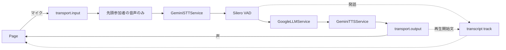

# moq-ai-voice-agent

`examples/browser/examples/moq-ai-voice-agent` と音声会話する Pipecat bot です。STT・LLM・TTS に Gemini を使い、音声は [`MoqWasmTransport`](https://nttcom.github.io/moq-wasm/docs/python/moq_wasm/pipecat.html#MoqWasmTransport) で送受信します。



| 役割 | Pipecat サービス | モデル |
| --- | --- | --- |
| 音声認識 | `GeminiSTTService` | `gemini-3.5-transcribe-live` |
| 応答 | `GoogleLLMService`（Vertex AI は `GoogleVertexLLMService`） | `gemini-3.6-flash` |
| 音声合成 | `GeminiTTSService` | `gemini-3.1-flash-tts-preview`（声: `Kore`） |

- Gemini API（`GOOGLE_API_KEY`）または Vertex AI（`--vertex-project` + ADC）を使用します（Vertex AI 時は STT/TTS のクライアントを差し替えます）。
- 話者分離のため最も早く入室した 1 人の音声のみ処理し、退出時に次の参加者へ切り替えます。最初の入室時には bot から挨拶します。

## 起動

一時アプリで Join 後「bot を参加させる」を押すと、[`bot-dispatcher`](../../../services/bot-dispatcher/README.md) が `voice-agent` として起動します（Public モード不可。参加者がいない状態が 30 秒続くか、最大 1 時間で終了）。

ローカルでは [Google AI Studio](https://aistudio.google.com/apikey) で Gemini API キーを取得し、`uv sync`（Rust ツールチェーン必須）のうえ `GOOGLE_API_KEY=<key>` 付きで `bot-dispatcher` を起動して `BOT_DISPATCHER_TYPES` に追加します:

```json
{
  "voice-agent": {
    "launcher": { "kind": "local", "program": "<リポジトリ>/examples/python/moq-ai-voice-agent/.venv/bin/python" },
    "args": ["-m", "moq_ai_voice_agent.bot", "--relay-url", "https://127.0.0.1:4433", "--insecure"],
    "grace_seconds": 30,
    "max_seconds": 3600,
    "max_running": 4
  }
}
```

Vertex AI を使う場合は `GOOGLE_API_KEY` の代わりに `args` へ `--vertex-project <プロジェクト ID>` を足します（ローカルは `gcloud auth application-default login`）。

## オプション

共通オプションは [moq-bot-job](../moq-bot-job/README.md) を参照してください。

| オプション | 既定値 | 内容 |
| --- | --- | --- |
| `--vertex-project` | なし | 指定プロジェクトの Vertex AI を使用（未指定時は `GOOGLE_API_KEY`） |

## トラック

`{app}` は一時アプリの appId（`temp-…`）。

| namespace | track | 内容 |
| --- | --- | --- |
| `{app}/moq-ai-voice-agent/{room}/{user}` | `catalog`, `mic_audio` | ページのマイク音声 |
| `{app}/moq-ai-voice-agent/{room}/bots/voice-agent` | `catalog`, `audio` | bot の音声 |
| `{app}/moq-ai-voice-agent/{room}/bots/voice-agent` | `transcript` | `draft-ietf-moq-msf-02` §8 の event timeline。`{"T": ms, "data": {"role": "user"\|"assistant", "text", "turn"}}`。返答は文の再生ごとに累積全文を同一 `turn`（最初のレコードの ms）で送信 |

## テスト

```shell
uv run pytest
```
