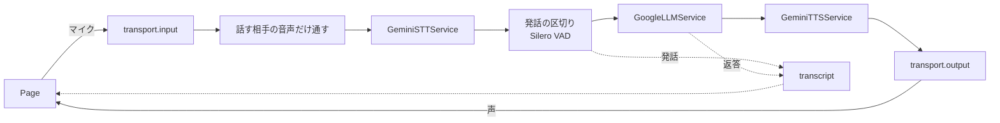

# moq-ai-voice-agent

MoQ AI Voice Agent（`examples/browser/examples/moq-ai-voice-agent`）のページに HTTP で呼ばれてルームに入り、音声で会話する pipecat の bot です。
音声認識・応答・音声合成をそれぞれ Gemini で行うカスケード構成で、音声は [`moq_wasm.pipecat.MoqWasmTransport`](../../../crates/python/README.md#pipecat) で送受信します。



| 役割 | pipecat のサービス | モデル（pipecat の既定値） |
| --- | --- | --- |
| 音声認識 | `GeminiSTTService` | `gemini-3.5-transcribe-live` |
| 応答 | `GoogleLLMService` | `gemini-3.6-flash` |
| 音声合成 | `GeminiTTSService`（Gemini API） | `gemini-3.1-flash-tts-preview`、声は `Kore` |

bot が聞くのは、ルームにいる参加者のうち最も早く入った 1 人です。その人が抜けると、次に早く入った人を聞きます。複数人の声を 1 本の音声認識に混ぜると、話者を区別できないためです。

## 起動

[Google AI Studio](https://aistudio.google.com/apikey) で Gemini API キーを取得し、各コマンドを別々のターミナルで実行します。

```shell
make relay
make browser

cd examples/python/moq-ai-voice-agent
GOOGLE_API_KEY=<API キー> uv run python -m moq_ai_voice_agent.bot --insecure
```

- `http://localhost:5173/moq-wasm/examples/moq-ai-voice-agent/` を開き、Local relay を選んで Join し、話しかけます。
- Cloud relay を使うときは bot を `--relay-url https://relay-1.moqt.research.skyway.io:443` で起動し、ページを `?botUrl=http://127.0.0.1:8101` 付きで開きます。
- bot は `http://127.0.0.1:8101` で待ち受けます。`moq-wasm` のビルドに Rust のツールチェーンが要ります。
- リクエストが閉じてから、または参加者が全員いなくなってから 30 秒たつと、bot はルームを抜けます。

## オプション

[moq-bot-rooms](../moq-bot-rooms/README.md) のオプションに加えて次があります。

| オプション | 既定値 | 内容 |
| --- | --- | --- |
| `--relay-url` | `https://127.0.0.1:4433` | 接続する relay |
| `--insecure` | なし | relay の証明書を検証しない |
| `--max-rooms` | `4` | 同時に動かすルームの数 |

## トラック

`anon` は一時アプリのルームでは appId（`temp-…`）になります。

| namespace | track | 内容 |
| --- | --- | --- |
| `anon/moq-ai-voice-agent/{room}/{user}` | `catalog`、`mic_audio` | ページが publish するマイク |
| `anon/moq-ai-voice-agent/{room}/gemini/voice` | `catalog`、`audio` | bot の声 |
| `anon/moq-ai-voice-agent/{room}/gemini/transcript` | `transcript` | draft-ietf-moq-msf-02 §8 の event timeline。`{"T": ms, "data": {"role": "user" か "assistant", "text"}}` |

## テスト

```shell
uv run pytest
```
