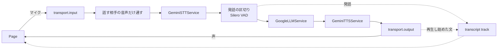

# moq-ai-voice-agent

MoQ AI Voice Agent（`examples/browser/examples/moq-ai-voice-agent`）のページに HTTP で呼ばれてルームに入り、音声で会話する pipecat の bot です。
音声認識・応答・音声合成をそれぞれ Gemini で行うカスケード構成で、音声は [`moq_wasm.pipecat.MoqWasmTransport`](https://nttcom.github.io/moq-wasm/docs/python/moq_wasm/pipecat.html#MoqWasmTransport) で送受信します。



| 役割 | pipecat のサービス | モデル |
| --- | --- | --- |
| 音声認識 | `GeminiSTTService` | `gemini-3.5-transcribe-live` |
| 応答 | `GoogleLLMService`（Vertex AI では `GoogleVertexLLMService`） | `gemini-3.6-flash` |
| 音声合成 | `GeminiTTSService` | `gemini-3.1-flash-tts-preview`、声は `Kore` |

Gemini は、Gemini API を `GOOGLE_API_KEY` で呼ぶか、`--vertex-project` で指定したプロジェクトの Vertex AI（global）をアプリケーションのデフォルト認証情報で呼びます。pipecat の Gemini STT と TTS は Gemini API にしかつながらないので、Vertex AI では bot が Vertex AI のクライアントに差し替えます。

bot が聞くのは、ルームにいる参加者のうち最も早く入った 1 人です。その人が抜けると、次に早く入った人を聞きます。複数人の声を 1 本の音声認識に混ぜると、話者を区別できないためです。

誰もいないルームに人が入ると、bot から先に挨拶します。入った人に、話しかけてよいことがわかるようにするためです。

## 起動

bot サービス（[`services/bot-dispatcher`](../../../docs/architecture/bot-dispatcher/architecture.md)）が、ルームごとに `voice-agent` 型の bot として起動します。
一時アプリのページは Join したあと「bot を参加させる」を押すと temporary-apps の `/bots/voice-agent` を呼び、bot はルームに誰もいない状態が 30 秒続くか 1 時間たつと抜けます。Public モードのページでは bot は動きません。

手元では、[Google AI Studio](https://aistudio.google.com/apikey) で Gemini API キーを取得して `uv sync` で `.venv` を作り、`bot-dispatcher` の `BOT_DISPATCHER_TYPES` に次を足します（`bot-dispatcher` の起動は [moq-meeting-transcriber](../moq-meeting-transcriber/README.md) と同じです）。
`bot-dispatcher` は自分の環境変数を bot に引き継ぐので、`bot-dispatcher` を `GOOGLE_API_KEY=<API キー>` で起動します。

```json
{
  "voice-agent": {
    "launcher": { "kind": "local", "program": "<リポジトリ>/examples/python/moq-ai-voice-agent/.venv/bin/python" },
    "args": ["-m", "moq_ai_voice_agent.bot", "--relay-url", "https://127.0.0.1:4433", "--insecure"],
    "grace_seconds": 30,
    "max_seconds": 3600,
    "max_running": 4
  }
}
```

- Vertex AI で動かすときは、`GOOGLE_API_KEY` の代わりに `args` に `--vertex-project <プロジェクト ID>` を足します。手元では `gcloud auth application-default login` の認証情報を使います。
- `moq-wasm` のビルドに Rust のツールチェーンが要ります。

## オプション

bot サービスが付ける引数と、接続先・TLS のオプションは [moq-bot-job](../moq-bot-job/README.md) を参照してください。`args` にはさらに次を書けます。

| オプション | 既定値 | 内容 |
| --- | --- | --- |
| `--vertex-project` | なし | Gemini をこのプロジェクトの Vertex AI で呼ぶ。なければ Gemini API を `GOOGLE_API_KEY` で呼ぶ |

## トラック

`{app}` は一時アプリの appId（`temp-…`）です。

| namespace | track | 内容 |
| --- | --- | --- |
| `{app}/moq-ai-voice-agent/{room}/{user}` | `catalog`、`mic_audio` | ページが publish するマイク |
| `{app}/moq-ai-voice-agent/{room}/bots/voice-agent` | `catalog`、`audio` | bot の声 |
| `{app}/moq-ai-voice-agent/{room}/bots/voice-agent` | `transcript` | draft-ietf-moq-msf-02 §8 の event timeline。`{"T": ms, "data": {"role": "user" か "assistant", "text", "turn"}}`。bot の返答は、1 文が再生され始めるごとにそこまでの全文を送る。同じ返答のレコードは同じ `turn`（最初のレコードの ms）を持つ |

## テスト

```shell
uv run pytest
```
