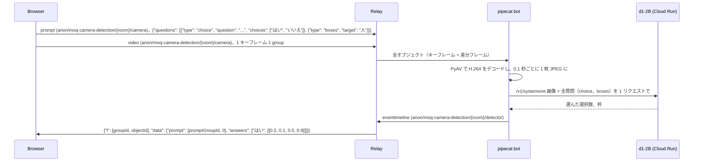

# moq-camera-detection

ブラウザの MoQ Camera Detection ページ（`examples/browser/examples/moq-camera-detection`）が H.264 で配信したカメラ映像を
pipecat の bot がこのリポジトリの Python バインディング [`moqt`](../../../crates/python) で受け取り、Cloud Run 上の決定モデル [d1-2B](https://huggingface.co/LiquidAI/d1-2B) で
ページが送った質問（最大 8 個）に答えます。質問は、選択肢から 1 つを選ぶ「選択式」と、探すものをすべて枠で示す「枠」の 2 種類です。
答えは MSF の event timeline として publish され、ページは答えを質問ごとに表示し、枠をプレビューに重ねて描きます。



## d1-2B

System One の `/v1/systemone` に画像付きで答える Cloud Run サービス `moqt-system-one`（asia-southeast1、MoQ Chat Moderation・MoQ PTZ Tracking と共用）です。
IAM 認証が必須なので、bot を起動するアカウントには `roles/run.invoker` が必要です。手元では `--gcloud-auth`、Cloud Run や GCE では `--metadata-auth` で ID トークンを送ります。停止後の最初の判定はコールドスタートで待たされます。
デプロイ手順は [d1-2B を Cloud Run にデプロイする](../system-one-on-cloud-run.md) にあります。

選択式は `/v1/systemone` の choice 型で送り、選択肢を criteria にします。返った choice が選択肢になければ「判定できません」と表示します。
枠は boxes 型（「Every 人.」、最大 8 個）で送り、見つかった枠を画面に対する割合 `[left, top, right, bottom]` で返します。

## 起動

Cloud relay で試すだけなら bot を起動する必要はありません。ページを開いて既定の Cloud relay-1 のまま Join すると、
ページは Cloud Run で動く bot（`https://moq-camera-detection.moqt.research.skyway.io`）にルームの bot を頼みます。
デプロイした bot は平日 9:00〜17:30 だけルームを動かし、1 つのルームは 1 時間で止めます。

ルームは URL の `room` で、なければページが作って URL に書きます。同じ `room` の URL を開くと同じルームに入ります。

手元で試すときは relay も手元で起動します。ローカルの relay を選んだページは、手元の bot（`http://127.0.0.1:8098`）を頼みます。
`botUrl` で bot の URL を指定することもできます。各コマンドを別々のターミナルで実行します。

1. relay を起動する

   ```shell
   make relay
   ```

2. bot を起動する

   bot は `moqt` を `crates/python` からビルドするので、Rust のツールチェーンが要ります。初回の `uv run` はビルドに数分かかります。

   ```shell
   cd examples/python/moq-camera-detection
   uv run python -m moq_camera_detection.bot --insecure \
     --system-one-url "$(gcloud run services describe moqt-system-one --region asia-southeast1 --format 'value(status.url)')/v1/systemone" \
     --gcloud-auth
   ```

   `--insecure` は手元の relay の自己署名証明書を検証しない指定です。bot は `http://127.0.0.1:8098` で待ち受け、
   ページが参加したルームごとに relay につなぎます。1 つのカメラで d1-2B の処理が埋まるため、既定では同時に 1 ルームです。
   オプションは [moq-bot-rooms](../moq-bot-rooms/README.md) にあります。

3. ページを開く

   ```shell
   make browser
   make chrome
   ```

   `make chrome` で起動した Chrome でハブから MoQ Camera Detection を開き、Local relay-a を選んで Join します。

## トラック

| namespace | track | 送信元 | 内容 |
| --- | --- | --- | --- |
| `anon/moq-camera-detection/{room}/camera` | `prompt` | ブラウザ | `{"questions": [...]}`。適用するたびに 1 件 1 group で送る。質問は 1〜8 個。選択式 `{"type": "choice", "question", "choices"}` は質問 200 文字以内、選択肢 2〜9 個で各 40 文字以内。枠 `{"type": "boxes", "target"}` は 100 文字以内 |
| `anon/moq-camera-detection/{room}/camera` | `video` | ブラウザ | H.264 Annex B（640x480、ソフトウェアエンコード）。キーフレームごとに group を始める |
| `anon/moq-camera-detection/{room}/detector` | `eventtimeline` | bot | draft-ietf-moq-msf-01 §8 の event timeline。`l` で判定したフレーム、`data.prompt` で使った prompt の位置を指す。`data.answers` は質問の順に、選択式は選んだ選択肢（選択肢外なら `null`）、枠は `[[left, top, right, bottom], ...]` |

- bot は group ごとにデコーダを作って全フレームをデコードし、0.1 秒ごとに 1 枚を判定に回します。判定中のリクエストが 8 件に
  達している間の画像と、デコードから 2 秒以上たった画像は捨てるので、コールドスタート中にたまったフレームは判定されません。
- 判定は並列に走るため、新しいフレームの判定より後に返ってきた古いフレームの判定は publish しません。
- relay とのセッションが閉じると、bot は 2 秒後に接続し直します。relay のプロセスが落ちた場合、bot が切断に気づくまで約 35 秒かかります。
- ページは最後に送った prompt の答えだけを表示します。prompt は `anon/` 配下なので、同じ relay の誰でも送れます。
- ブラウザはハードウェアエンコーダを使いません。macOS のハードウェアエンコーダは、偽カメラのファイル入力など一部のフレームで
  数フレーム出力したあと止まるためです。

## テスト

```shell
uv run pytest
```

E2E はリポジトリのルートで実行します。relay・VTS・vite・偽の System One サーバ・bot を起動し、Playwright の偽カメラでページを操作します。

```shell
node tests/browser-e2e/run-camera-detection-e2e.mjs
```
