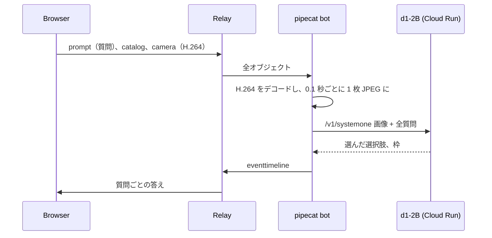

# moq-camera-detection

ブラウザの MoQ Camera Detection ページ（`examples/browser/examples/moq-camera-detection`）が配信したカメラ映像を pipecat の bot が受け取り、決定モデル [d1-2B](https://huggingface.co/LiquidAI/d1-2B) でページの質問（最大 8 個）に答えます。
質問は、選択肢から 1 つを選ぶ「選択式」と、探すものを枠で示す「枠」の 2 種類です。答えは MSF の event timeline として publish され、ページが表示します。



## d1-2B

d1-2B は Cloud Run サービス `moqt-system-one`（asia-southeast1、他の bot と共用）の `/v1/systemone` で答えます。
IAM 認証が必須なので、bot を起動するアカウントには `roles/run.invoker` が必要です。手元では `--gcloud-auth`、Cloud Run や GCE では `--metadata-auth` で ID トークンを送ります。
デプロイ手順は [d1-2B を Cloud Run にデプロイする](../system-one-on-cloud-run.md) にあります。

## 起動

Cloud relay で試すだけなら bot の起動は要りません。ページを既定の Cloud relay-1 のまま Join すると、Cloud Run の bot（平日 9:00〜17:30、1 ルーム 1 時間まで）がルームに入ります。
ルームは URL の `room` で決まり、同じ URL を開くと同じルームに入ります。

手元で試すときは、各コマンドを別々のターミナルで実行します。

```shell
make relay

cd examples/python/moq-camera-detection
uv run python -m moq_camera_detection.bot --insecure \
  --system-one-url "$(gcloud run services describe moqt-system-one --region asia-southeast1 --format 'value(status.url)')/v1/systemone" \
  --gcloud-auth

make browser
make chrome
```

- bot は `moq-wasm` を `crates/python` からビルドするので、Rust のツールチェーンが要ります。
- bot は `http://127.0.0.1:8098` で待ち受けます。同時に動かせるのは既定で 1 ルームです。オプションは [moq-bot-rooms](../moq-bot-rooms/README.md) にあります。
- `make chrome` の Chrome でハブから MoQ Camera Detection を開き、Local relay-a を選んで Join します。`?botUrl=` で bot の URL を指定できます。

## トラック

一時アプリのページでは、`anon` の代わりにその appId（`temp-…`）が namespace root になります。

| namespace | track | 送信元 | 内容 |
| --- | --- | --- | --- |
| `anon/moq-camera-detection/{room}/camera` | `prompt` | ブラウザ | `{"questions": [...]}`（1〜8 個）。選択式は `{"type": "choice", "question", "choices"}`、枠は `{"type": "boxes", "target"}` |
| `anon/moq-camera-detection/{room}/camera` | `catalog`、`camera` | ブラウザ | MSF catalog と H.264 の映像。キーフレームごとに group を始める |
| `anon/moq-camera-detection/{room}/detector` | `eventtimeline` | bot | draft-ietf-moq-msf-01 §8 の event timeline。`l` で判定したフレーム、`data.answers` で質問の順の答え（枠は `[[left, top, right, bottom], ...]`）を示す |

- 判定が追いつかない間の画像と、デコードから 2 秒以上たった画像は捨てます。
- relay とのセッションが閉じると、bot は 2 秒後に接続し直します。

## テスト

```shell
uv run pytest
node tests/browser-e2e/run-camera-detection-e2e.mjs   # E2E。リポジトリのルートで実行する
```
