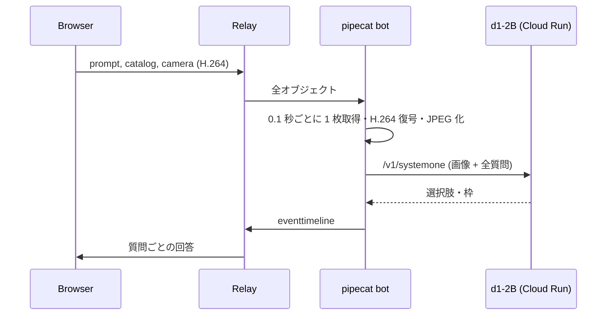

# moq-camera-detection

`examples/browser/examples/moq-camera-detection` のカメラ映像を [d1-2B](https://huggingface.co/LiquidAI/d1-2B) で判定し、選択式（`choice`）および領域検出（`boxes`）の質問（最大 8 問）への回答を MSF event timeline で返す Pipecat bot です。



## d1-2B

Cloud Run `moqt-system-one`（asia-southeast1、他 bot と共用）の `/v1/systemone` を呼び出します（デプロイ手順: [system-one-on-cloud-run.md](../system-one-on-cloud-run.md)）。
IAM 認証（`roles/run.invoker`）が必須のため、ローカルでは `--gcloud-auth`、Cloud Run/GCE では `--metadata-auth` を指定します。

## 起動

一時アプリで Join 後「bot を参加させる」を押すと、[`bot-dispatcher`](../../../services/bot-dispatcher/README.md) が `camera-detection` として起動します（Public モード不可。参加者がいない状態が 30 秒続くか、最大 1 時間で終了）。

ローカルでは `uv sync`（Rust ツールチェーン必須）後、`BOT_DISPATCHER_TYPES` に追加します（System One は並列 1 件のため `max_running: 1`）。共通オプションは [moq-bot-job](../moq-bot-job/README.md) を参照してください:

```json
{
  "camera-detection": {
    "launcher": { "kind": "local", "program": "<リポジトリ>/examples/python/moq-camera-detection/.venv/bin/python" },
    "args": ["-m", "moq_camera_detection.bot", "--relay-url", "https://127.0.0.1:4433", "--insecure",
             "--system-one-url", "<System One の URL>/v1/systemone", "--gcloud-auth"],
    "grace_seconds": 30,
    "max_seconds": 3600,
    "max_running": 1
  }
}
```

## トラック

`{app}` は一時アプリの appId（`temp-…`）。

| namespace | track | 送信元 | 内容 |
| --- | --- | --- | --- |
| `{app}/moq-camera-detection/{room}/camera` | `prompt` | ブラウザ | `{"questions": [...]}`（1〜8 問）。`{"type": "choice", "question", "choices"}` または `{"type": "boxes", "target"}` |
| `{app}/moq-camera-detection/{room}/camera` | `catalog`, `camera` | ブラウザ | MSF catalog と H.264（キーフレームで group 開始） |
| `{app}/moq-camera-detection/{room}/bots/camera-detection` | `eventtimeline` | bot | `draft-ietf-moq-msf-02` §8 の event timeline。`L` で対象フレーム、`data.answers` で質問順の回答（枠は `[[left, top, right, bottom], ...]`） |

- 推論待ち中のフレームおよび復号後 2 秒超過フレームは破棄します。
- セッション切断時は 2 秒後に再接続します。

## テスト

```shell
uv run pytest
node tests/browser-e2e/run-camera-detection-e2e.mjs   # リポジトリルートで実行
```
