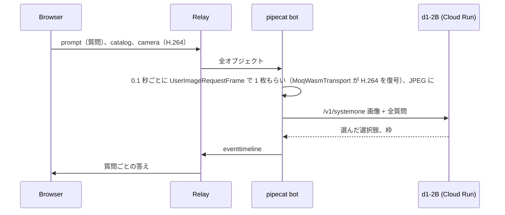

# moq-camera-detection

ブラウザの MoQ Camera Detection ページ（`examples/browser/examples/moq-camera-detection`）が配信したカメラ映像を pipecat の bot が受け取り、決定モデル [d1-2B](https://huggingface.co/LiquidAI/d1-2B) でページの質問（最大 8 個）に答えます。
質問は、選択肢から 1 つを選ぶ「選択式」と、探すものを枠で示す「枠」の 2 種類です。答えは MSF の event timeline として publish され、ページが表示します。



## d1-2B

d1-2B は Cloud Run サービス `moqt-system-one`（asia-southeast1、他の bot と共用）の `/v1/systemone` で答えます。
IAM 認証が必須なので、bot を起動するアカウントには `roles/run.invoker` が必要です。手元では `--gcloud-auth`、Cloud Run や GCE では `--metadata-auth` で ID トークンを送ります。
デプロイ手順は [d1-2B を Cloud Run にデプロイする](../system-one-on-cloud-run.md) にあります。

## 起動

bot サービス（[`services/bot-dispatcher`](../../../docs/architecture/bot-dispatcher/architecture.md)）が、ルームごとに `camera-detection` 型の bot として起動します。
一時アプリのページは Join したあと「bot を参加させる」を押すと temporary-apps の `/bots/camera-detection` を呼び、bot はルームに誰もいない状態が 30 秒続くか 1 時間たつと抜けます。
ルームは URL の `room` で決まり、同じ URL を開くと同じルームに入ります。Public モードのページでは bot は動きません。

手元では、`uv sync` で `.venv` を作り、`bot-dispatcher` の `BOT_DISPATCHER_TYPES` に次を足します（`bot-dispatcher` の起動は [moq-meeting-transcriber](../moq-meeting-transcriber/README.md) と同じです）。
System One は 1 度に 1 つの問いにしか答えないので、同時に動かす bot は 1 つです。

```json
{
  "camera-detection": {
    "launcher": { "kind": "local", "program": "<リポジトリ>/examples/python/moq-camera-detection/.venv/bin/python" },
    "args": ["-m", "moq_camera_detection.bot", "--relay-url", "https://127.0.0.1:4433", "--insecure",
             "--system-one-url", "<System One の URL>/v1/systemone", "--gcloud-auth"],
    "grace_seconds": 30,
    "max_seconds": 3600,
    "max_running": 1
  }
}
```

- bot は `moq-wasm` を `crates/python` からビルドするので、Rust のツールチェーンが要ります。
- 起動のオプションは [moq-bot-job](../moq-bot-job/README.md) の「bot サービスから起動される bot」にあります。

## トラック

`{app}` は一時アプリの appId（`temp-…`）です。

| namespace | track | 送信元 | 内容 |
| --- | --- | --- | --- |
| `{app}/moq-camera-detection/{room}/camera` | `prompt` | ブラウザ | `{"questions": [...]}`（1〜8 個）。選択式は `{"type": "choice", "question", "choices"}`、枠は `{"type": "boxes", "target"}` |
| `{app}/moq-camera-detection/{room}/camera` | `catalog`、`camera` | ブラウザ | MSF catalog と H.264 の映像。キーフレームごとに group を始める |
| `{app}/moq-camera-detection/{room}/bots/camera-detection` | `eventtimeline` | bot | draft-ietf-moq-msf-02 §8 の event timeline。`L` で判定したフレーム、`data.answers` で質問の順の答え（枠は `[[left, top, right, bottom], ...]`）を示す |

- 判定が追いつかない間の画像と、デコードから 2 秒以上たった画像は捨てます。
- relay とのセッションが閉じると、bot は 2 秒後に接続し直します。

## テスト

```shell
uv run pytest
node tests/browser-e2e/run-camera-detection-e2e.mjs   # E2E。リポジトリのルートで実行する
```
