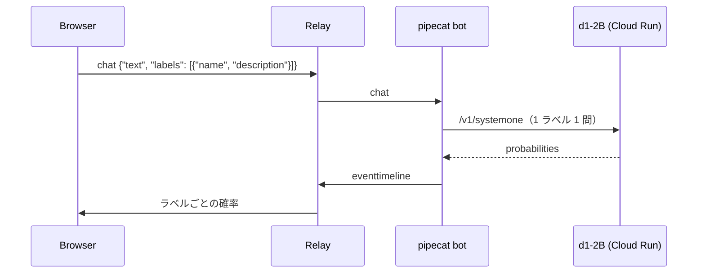

# moq-chat-moderation

ブラウザの MoQ Chat Moderation ページ（`examples/browser/examples/moq-chat-moderation`）のチャットを pipecat の bot が受け取り、決定モデル [d1-2B](https://huggingface.co/LiquidAI/d1-2B) でラベルごとに当てはまる確率を判定します。
ラベル（名前と説明）はページで足したり消したりでき、既定は 喜・怒・哀・楽・暴言・スパム です。
判定は MSF の event timeline として publish されます。ページは確率 0.7 以上のラベルをメッセージの横に出し、「暴言」のメッセージを「モデレーターによって削除されました」に置き換えます。



d1-2B の認証とデプロイは [moq-camera-detection](../moq-camera-detection/README.md#d1-2b) と同じです。

## 起動

Cloud relay で試すだけなら bot の起動は要りません。ページを既定の Cloud relay-1 のまま Join すると、Cloud Run の bot（平日 9:00〜17:30、1 ルーム 1 時間まで）がルームに入ります。
ルームは URL の `room` で決まり、同じ URL を開くと同じルームに入ります。

手元で試すときは、各コマンドを別々のターミナルで実行します。

```shell
make relay

cd examples/python/moq-chat-moderation
uv run python -m moq_chat_moderation.bot --insecure \
  --system-one-url "$(gcloud run services describe moqt-system-one --region asia-southeast1 --format 'value(status.url)')/v1/systemone" \
  --gcloud-auth

make browser
make chrome
```

- bot は `moqt` を `crates/python` からビルドするので、Rust のツールチェーンが要ります。
- bot は `http://127.0.0.1:8097` で待ち受けます（同時に 10 ルームまで）。オプションは [moq-bot-rooms](../moq-bot-rooms/README.md) にあります。
- `make chrome` の Chrome でハブから MoQ Chat Moderation を開き、Local relay-a を選んで Join します。モデレーター接続済みになったら送信できます。

## トラック

一時アプリのページでは、`anon` の代わりにその appId（`temp-…`）が namespace root になります。

| namespace | track | 送信元 | 内容 |
| --- | --- | --- | --- |
| `anon/moq-chat-moderation/{room}/chat` | `chat` | ブラウザ | `{"text": "...", "labels": [{"name": "喜", "description": "..."}]}`。1 メッセージ 1 group |
| `anon/moq-chat-moderation/{room}/moderator` | `eventtimeline` | bot | draft-ietf-moq-msf-01 §8 の event timeline。`l` で chat の Location を指し、`data` は `{"labels": [{"name": "喜", "probability": 0.91}]}` |
| `anon/moq-chat-moderation/{room}/moderator` | `status` | bot | System One の状態 `{"system_one", "since"}` |

- ラベルは 0〜16 個で、名前は 1〜20 文字、説明は 100 文字以内です。
- 1 つのルームでチャットを送れるページは同時に 1 つです。そのページが去ると、残ったページが送れるようになります。

## テスト

```shell
uv run pytest
node tests/browser-e2e/run-chat-moderation-e2e.mjs   # E2E。リポジトリのルートで実行する
```
