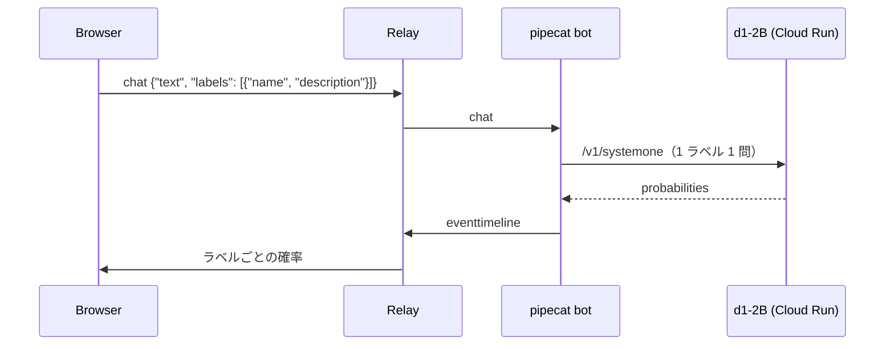

# moq-chat-moderation

ブラウザの MoQ Chat Moderation ページ（`examples/browser/examples/moq-chat-moderation`）のチャットを pipecat の bot が受け取り、決定モデル [d1-2B](https://huggingface.co/LiquidAI/d1-2B) でラベルごとに当てはまる確率を判定します。
ラベル（名前と説明）はページで足したり消したりでき、既定は 喜・怒・哀・楽・暴言・スパム です。
判定は MSF の event timeline として publish されます。ページは確率 0.7 以上のラベルをメッセージの横に出し、「暴言」のメッセージを「モデレーターによって削除されました」に置き換えます。



d1-2B の認証とデプロイは [moq-camera-detection](../moq-camera-detection/README.md#d1-2b) と同じです。

## 起動

bot サービス（[`services/bot-dispatcher`](../../../docs/architecture/bot-dispatcher/architecture.md)）が、ルームごとに `chat-moderation` 型の bot として起動します。
一時アプリのページは Join したあと「bot を参加させる」を押すと temporary-apps の `/bots/chat-moderation` を呼び、bot はルームに誰もいない状態が 30 秒続くか 1 時間たつと抜けます。
ルームは URL の `room` で決まり、同じ URL を開くと同じルームに入ります。Public モードのページでは bot は動きません。

手元では、`uv sync` で `.venv` を作り、`bot-dispatcher` の `BOT_DISPATCHER_TYPES` に次を足します（`bot-dispatcher` の起動は [moq-meeting-transcriber](../moq-meeting-transcriber/README.md) と同じです）。
System One の URL は `gcloud run services describe moqt-system-one --region asia-southeast1 --format 'value(status.url)'` で分かります。

```json
{
  "chat-moderation": {
    "launcher": { "kind": "local", "program": "<リポジトリ>/examples/python/moq-chat-moderation/.venv/bin/python" },
    "args": ["-m", "moq_chat_moderation.bot", "--relay-url", "https://127.0.0.1:4433", "--insecure",
             "--system-one-url", "<System One の URL>/v1/systemone", "--gcloud-auth"],
    "grace_seconds": 30,
    "max_seconds": 3600,
    "max_running": 10
  }
}
```

- bot は `moq-wasm` を `crates/python` からビルドするので、Rust のツールチェーンが要ります。
- 起動のオプションは [moq-bot-job](../moq-bot-job/README.md) の「bot サービスから起動される bot」にあります。

## トラック

`{app}` は一時アプリの appId（`temp-…`）です。

| namespace | track | 送信元 | 内容 |
| --- | --- | --- | --- |
| `{app}/moq-chat-moderation/{room}/chat` | `chat` | ブラウザ | `{"text": "...", "labels": [{"name": "喜", "description": "..."}]}`。1 メッセージ 1 group |
| `{app}/moq-chat-moderation/{room}/bots/chat-moderation` | `eventtimeline` | bot | draft-ietf-moq-msf-02 §8 の event timeline。`L` で chat の Location を指し、`data` は `{"labels": [{"name": "喜", "probability": 0.91}]}` |
| `{app}/moq-chat-moderation/{room}/bots/chat-moderation` | `status` | bot | System One の状態 `{"system_one", "since"}` |

- ラベルは 0〜16 個で、名前は 1〜20 文字、説明は 100 文字以内です。
- 1 つのルームでチャットを送れるページは同時に 1 つです。そのページが去ると、残ったページが送れるようになります。

## テスト

```shell
uv run pytest
node tests/browser-e2e/run-chat-moderation-e2e.mjs   # E2E。リポジトリのルートで実行する
```
