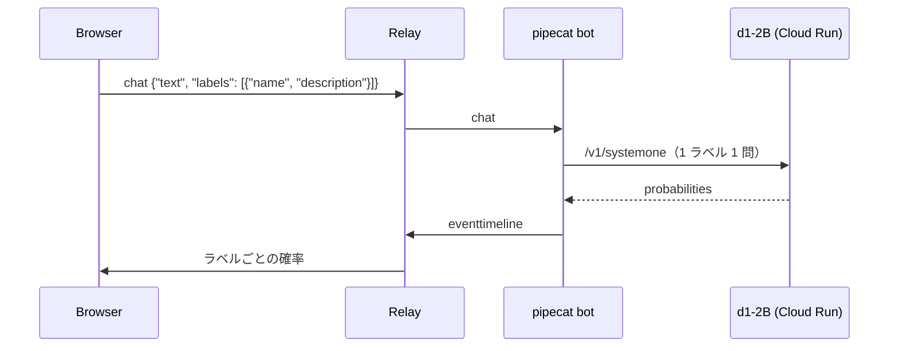

# moq-chat-moderation

`examples/browser/examples/moq-chat-moderation` のチャットを [d1-2B](https://huggingface.co/LiquidAI/d1-2B) でラベル判定（既定: 喜・怒・哀・楽・暴言・スパム、編集可）し、確率を MSF event timeline で返す Pipecat bot です。ブラウザは確率 0.7 以上のラベルを表示し、「暴言」を削除表示に置換します。



d1-2B の認証・デプロイは [moq-camera-detection](../moq-camera-detection/README.md#d1-2b) と同じです。

## 起動

一時アプリで Join 後「bot を参加させる」を押すと、[`bot-dispatcher`](../../../services/bot-dispatcher/README.md) が `chat-moderation` として起動します（Public モード不可。参加者がいない状態が 30 秒続くか、最大 1 時間で終了）。

ローカルでは `uv sync`（Rust ツールチェーン必須）後、`BOT_DISPATCHER_TYPES` に追加します（共通オプション: [moq-bot-job](../moq-bot-job/README.md)）。System One の URL は `gcloud run services describe moqt-system-one --region asia-southeast1 --format 'value(status.url)'` で取得できます:

```json
{
  "chat-moderation": {
    "launcher": { "kind": "local", "program": "<リポジトリ>/examples/python/moq-chat-moderation/.venv/bin/python" },
    "args": ["-m", "moq_chat_moderation.bot", "--relay-url", "https://127.0.0.1:4433", "--insecure",
             "--system-one-url", "<System One の URL>/v1/systemone", "--gcloud-auth"],
    "grace_seconds": 30,
    "max_seconds": 3600,
    "max_running": 10
  }
}
```

## トラック

`{app}` は一時アプリの appId（`temp-…`）。

| namespace | track | 送信元 | 内容 |
| --- | --- | --- | --- |
| `{app}/moq-chat-moderation/{room}/chat` | `chat` | ブラウザ | `{"text": "...", "labels": [{"name": "喜", "description": "..."}]}`（1 メッセージ 1 group） |
| `{app}/moq-chat-moderation/{room}/bots/chat-moderation` | `eventtimeline` | bot | `draft-ietf-moq-msf-02` §8 の event timeline。`L` で chat の Location、`data` で `{"labels": [{"name": "喜", "probability": 0.91}]}` |
| `{app}/moq-chat-moderation/{room}/bots/chat-moderation` | `status` | bot | System One の状態 `{"system_one", "since"}` |

- ラベルは 0〜16 個（名前 1〜20 文字、説明 100 文字以内）。
- 1 ルームで同時にチャット送信できるページは 1 つです（退出時に他ページへ移行）。

## テスト

```shell
uv run pytest
node tests/browser-e2e/run-chat-moderation-e2e.mjs   # リポジトリルートで実行
```
