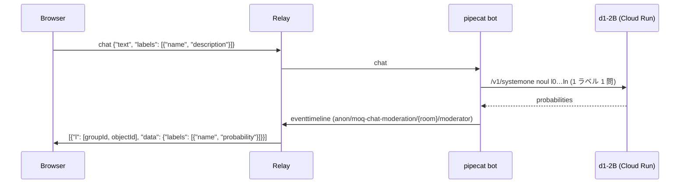

# moq-chat-moderation

ブラウザの MoQ Chat Moderation ページ（`examples/browser/examples/moq-chat-moderation`）で打ったチャットを
pipecat の bot がこのリポジトリの Python バインディング [`moqt`](../../../crates/python) で受け取り、Cloud Run 上の決定モデル [d1-2B](https://huggingface.co/LiquidAI/d1-2B) でラベルごとに当てはまる確率を判定します。
ラベルは名前と説明の組で、ページの欄で足したり消したりでき、送信時点の欄のラベルがメッセージと一緒に送られます。既定は 喜・怒・哀・楽・暴言・スパム です。
判定結果は MSF の event timeline として publish されます。ページは確率 0.7 以上のラベルをメッセージの横に出し、「暴言」が付いたメッセージを「モデレーターによって削除されました」に置き換えます。メッセージをクリックすると、全ラベルの確率がサイドバーに出ます。



## d1-2B

d1-2B は System One の `/v1/systemone` に答える Cloud Run サービス `moqt-system-one`（asia-southeast1、MoQ Camera Detection・MoQ PTZ Tracking と共用）として動いています。
IAM 認証が必須なので、bot を起動するアカウントには `roles/run.invoker` が必要です。bot は `--gcloud-auth` を付けると
`gcloud auth print-identity-token` の ID トークンを Bearer で送ります。Cloud Run や GCE では `--metadata-auth` を付けると、サービスアカウントの ID トークンをメタデータサーバーから取って送ります。`--min-instances=0` のため、しばらく使われずに停止した後の最初の判定は、コールドスタートで待たされます。
デプロイ手順は [d1-2B を Cloud Run にデプロイする](../system-one-on-cloud-run.md) にあります。

## 起動

Cloud relay で試すだけなら bot を起動する必要はありません。ページを開いて既定の Cloud relay-1 のまま Join すると、
ページは Cloud Run で動く bot（`https://moq-chat-moderation.moqt.research.skyway.io`）にルームの bot を頼みます。
デプロイした bot は平日 9:00〜17:30 だけルームを動かし、1 つのルームは 1 時間で止めます。

ルームは URL の `room` で、なければページが作って URL に書きます。同じ `room` の URL を開くと同じルームに入ります。

手元で試すときは relay も手元で起動します。ローカルの relay を選んだページは、手元の bot（`http://127.0.0.1:8097`）を頼みます。
`botUrl` で bot の URL を指定することもできます。各コマンドを別々のターミナルで実行します。

1. relay を起動する

   ```shell
   make relay
   ```

2. bot を起動する

   bot は `moqt` を `crates/python` からビルドするので、Rust のツールチェーンが要ります。初回の `uv run` はビルドに数分かかります。

   ```shell
   cd examples/python/moq-chat-moderation
   uv run python -m moq_chat_moderation.bot --insecure \
     --system-one-url "$(gcloud run services describe moqt-system-one --region asia-southeast1 --format 'value(status.url)')/v1/systemone" \
     --gcloud-auth
   ```

   `--insecure` は手元の relay の自己署名証明書を検証しない指定です。bot は `http://127.0.0.1:8097` で待ち受け、
   ページが参加したルームごとに relay につなぎます（同時に 10 ルームまで）。オプションは [moq-bot-rooms](../moq-bot-rooms/README.md) にあります。

3. ページを開く

   ```shell
   make browser
   make chrome
   ```

   `make chrome` で起動した Chrome でハブから MoQ Chat Moderation を開き、Local relay-a を選んで Join します。
   モデレーター接続済みになったら送信できます。

## トラック

| namespace | track | 送信元 | 内容 |
| --- | --- | --- | --- |
| `anon/moq-chat-moderation/{room}/chat` | `chat` | ブラウザ | `{"text": "...", "labels": [{"name": "喜", "description": "..."}]}` の JSON。1 メッセージ 1 group |
| `anon/moq-chat-moderation/{room}/moderator` | `eventtimeline` | bot | draft-ietf-moq-msf-01 §8 の event timeline。`l` で chat の Location を指し、`data` は `{"labels": [{"name": "喜", "probability": 0.91}]}` |
| `anon/moq-chat-moderation/{room}/moderator` | `status` | bot | System One の状態 `{"system_one", "since"}`。1 状態 1 group |

- ラベルは 0〜16 個で、名前は 1〜20 文字、説明は 100 文字以内、名前は重複できません。bot は 1 ラベル 1 問の noul を 1 リクエストで聞き、ラベルが 0 個のメッセージは判定しません。
- 質問文は「このチャットメッセージは「{名前}」（{説明}）に当てはまりますか？」です。手元の d1-2B で既定ラベルに日本語と英語の質問を比べ、スパムの判定が良かった日本語にしました。
- eventtimeline は relay につなぐたびに、それまでのすべての判定を持つ group を開き、以降の判定を 1 件 1 object で足します。
- group id は wall clock から採番します。relay は publisher が替わっても track のキャッシュを保持し、同じ Location を
  再利用した track を隔離するためです。
- ルームのページは同じ chat の namespace を publish し、relay は bot の SUBSCRIBE をそのうち 1 つに送るので、
  1 つのルームでチャットを送れるページは同時に 1 つです。そのページが去ると bot は購読し直し、残ったページが送れるようになります。

## テスト

```shell
uv run pytest
```

E2E はリポジトリのルートで実行します。relay・VTS・vite・偽の System One サーバ・bot を起動し、Playwright でページを操作します。

```shell
node tests/browser-e2e/run-chat-moderation-e2e.mjs
```
