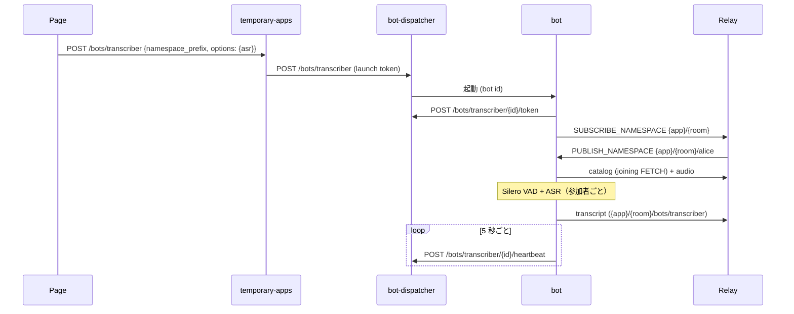

# moq-meeting-transcriber

Meeting（`examples/browser/examples/meeting`）の全参加者の音声を書き起こし、MSF event timeline で配信する Pipecat bot です（設計: [meeting-transcriber.md](../../../docs/architecture/ai-bots/meeting-transcriber.md)）。

起動オプション `asr` で音声認識バックエンドを選択します:

| `asr` | モデル | 実行先 |
| --- | --- | --- |
| `whisper`（既定） | faster-whisper `small`（`--model` で変更） | bot 内 CPU |
| `granite-speech-5-470m` | Granite Speech 5.0 470m | bot 内 CPU |
| `qwen3-asr` | Qwen3-ASR-1.7B | GPU Cloud Run（[asr-on-cloud-run.md](../asr-on-cloud-run.md)） |
| `granite-speech-5-2b` | Granite Speech 5.0 2b | GPU Cloud Run（同上） |
| `haas-ja` | Haas-ja-v1.0 | GPU Cloud Run（[haas-asr-server](../haas-asr-server/README.md)） |



## 起動

`uv sync`（Rust ツールチェーン必須、初回はモデル取得）のうえ、[`bot-dispatcher`](../../../services/bot-dispatcher/README.md) の `BOT_DISPATCHER_TYPES` に追加します:

```json
{
  "transcriber": {
    "launcher": { "kind": "local", "program": "<リポジトリ>/examples/python/moq-meeting-transcriber/.venv/bin/python" },
    "args": ["-m", "moq_meeting_transcriber.bot", "--relay-url", "https://127.0.0.1:4433", "--insecure"],
    "grace_seconds": 30,
    "max_seconds": 3600,
    "max_running": 2
  }
}
```

- Meeting からは一時アプリ経由（`TEMPORARY_APPS_BOT_TYPES` に `transcriber` を含める）で起動・停止します。
- 参加者がおらず書き起こしも完了した状態が `grace_seconds`（30 秒）続くと終了します。

## オプション

共通オプションは [moq-bot-job](../moq-bot-job/README.md) を参照してください。

| オプション | 既定値 | 内容 |
| --- | --- | --- |
| `--model` | `small` | `whisper` 用 faster-whisper モデル |
| `--asr NAME=URL` | なし | OpenAI 互換 ASR エンドポイント（複数可、`asr: NAME` で選択） |
| `--gcloud-auth` / `--metadata-auth` | なし | `--asr` 呼び出しに ID トークンを付与（ローカル: `gcloud` / Cloud Run: メタデータサーバ） |

## トラック

`{app}` は一時アプリの appId（`temp-…`）。

| namespace | track | 内容 |
| --- | --- | --- |
| `{app}/{room}/{user}` | `catalog`, 音声トラック（Meeting では `camera_audio`） | 参加者音声（Opus LOC の最低ビットレートを購読） |
| `{app}/{room}/bots/transcriber` | `transcript` | `draft-ietf-moq-msf-02` §8 の event timeline。`{"T": 発話開始 ms, "data": {"speaker", "text"}}` |
| `{app}/{room}/bots/transcriber` | `status` | `{"asr": 名前, "state": "starting"\|"ready"}` |

## テスト

```shell
uv run pytest
```
