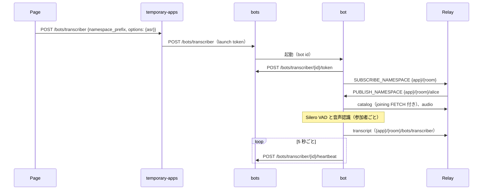

# moq-meeting-transcriber

Meeting（`examples/browser/examples/meeting`）のルームに入り、参加者全員の音声を書き起こす pipecat の bot です。
[bot サービス](../../../docs/architecture/bots/architecture.md)（`services/bots`）が、ルームごとに `transcriber` 型の bot として起動します。
書き起こしは MSF の event timeline として publish します。設計は [Live transcription for the Meeting example](../../../docs/architecture/ai-bots/meeting-transcriber.md) にあります。

音声認識は、ページが bot を起動するときのオプション `asr` で選びます。

| `asr` | モデル | 動く場所 |
| --- | --- | --- |
| `whisper`（既定） | faster-whisper `small`（`--model` で変更） | bot の中の CPU |
| `granite-speech-5-470m` | Granite Speech 5.0 470m | bot の中の CPU |
| `qwen3-asr` | Qwen3-ASR-1.7B | GPU の Cloud Run（[音声認識を Cloud Run の GPU にデプロイする](../asr-on-cloud-run.md)） |
| `granite-speech-5-2b` | Granite Speech 5.0 2b | GPU の Cloud Run（同上） |
| `haas-ja` | Haas-ja-v1.0 | GPU の Cloud Run（[haas-asr-server](../haas-asr-server/README.md)） |



## 起動

`bots` の `BOTS_TYPES` に `transcriber` 型を足します。手元では `local` launcher で bot の Python を起動します。

```json
{
  "transcriber": {
    "launcher": { "kind": "local", "program": "<リポジトリ>/examples/python/moq-meeting-transcriber/.venv/bin/python" },
    "args": ["-m", "moq_meeting_transcriber.bot", "--relay-url", "https://127.0.0.1:4433", "--insecure"],
    "grace_seconds": 30,
    "max_seconds": 3600,
    "max_running": 2
  }
}
```

- 先に `uv sync` で `.venv` を作ります。初回はモデルをダウンロードし、`moq-wasm` のビルドに Rust のツールチェーンが要ります。
- Meeting は一時アプリのページから temporary-apps service（`TEMPORARY_APPS_BOT_TYPES` に `transcriber`）を通して bot を起動・停止します。
- ルームに参加者がいない状態が 30 秒（`grace_seconds`）続くと、bot はルームを抜けて終わります。

## オプション

bot サービスが付ける引数と、接続先・TLS のオプションは [moq-bot-rooms](../moq-bot-rooms/README.md) を参照してください。`args` にはさらに次を書けます。

| オプション | 既定値 | 内容 |
| --- | --- | --- |
| `--model` | `small` | `whisper` で使う faster-whisper のモデル |
| `--asr NAME=URL` | なし | OpenAI 互換の API を持つ音声認識サービス。ページはオプション `asr: NAME` で選ぶ。複数指定できる |
| `--gcloud-auth` / `--metadata-auth` | なし | `--asr` のサービスに ID トークンを付ける。手元では `gcloud`、Cloud Run ではメタデータサーバーから取る |

## トラック

`{app}` は一時アプリの appId（`temp-…`）です。

| namespace | track | 内容 |
| --- | --- | --- |
| `{app}/{room}/{user}` | `catalog`、`audio_*` | 参加者が publish するもの。bot は最も高いビットレートの音声を購読する |
| `{app}/{room}/bots/transcriber` | `transcript` | draft-ietf-moq-msf-02 §8 の event timeline。`{"T": 発話開始の ms, "data": {"speaker", "text"}}` |
| `{app}/{room}/bots/transcriber` | `status` | `{"asr": 名前, "state": "starting" か "ready"}` |

## テスト

```shell
uv run pytest
```
