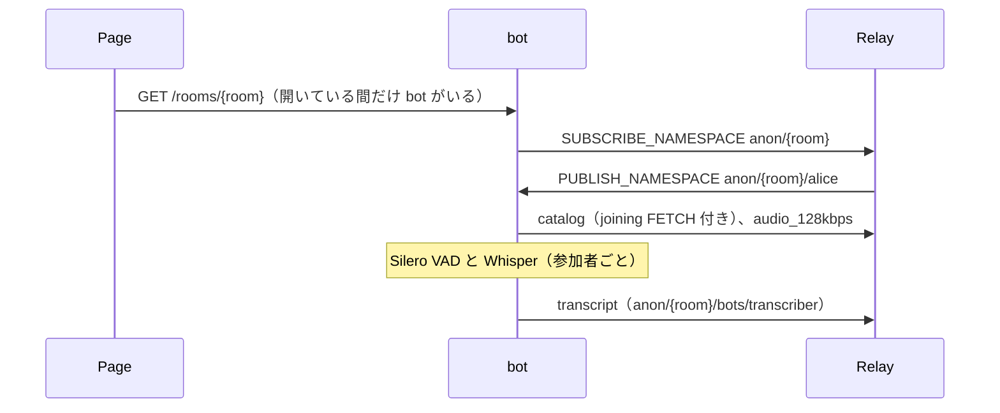

# moq-meeting-transcriber

Meeting（`examples/browser/examples/meeting`）のルームに HTTP で呼ばれて入り、参加者全員の音声を書き起こす pipecat の bot です。
音声認識は、ページがルームを頼むときに `?asr=` で選びます。

| `asr` | モデル | 動く場所 |
| --- | --- | --- |
| `whisper`（既定） | faster-whisper `medium`（`--model` で変更） | bot の中の CPU |
| `qwen3-asr` | Qwen3-ASR-1.7B | GPU の Cloud Run（[音声認識を Cloud Run の GPU にデプロイする](../asr-on-cloud-run.md)） |
| `moss-transcribe-diarize` | MOSS-Transcribe-Diarize 0.9B | GPU の Cloud Run（同上） |

書き起こしは MSF の event timeline として publish します。設計は [Live transcription for the Meeting example](../../../docs/architecture/ai-bots/meeting-transcriber.md) にあります。

relay とは、このリポジトリの Python バインディング [`moqt`](../../../crates/python/README.md) でつなぎます。



## 起動

各コマンドを別々のターミナルで実行します。

1. relay を起動する

   ```shell
   make relay
   ```

2. bot を起動する

   ```shell
   cd examples/python/moq-meeting-transcriber
   uv run python -m moq_meeting_transcriber.bot --insecure
   ```

   `--insecure` は手元の relay の自己署名証明書を検証しない指定です。bot は `http://127.0.0.1:8100` で待ち受け、
   最初に Whisper のモデル（既定は `medium`）を読み込みます。初回はモデルをダウンロードします。
   `moqt` を maturin でビルドするので、初回の `uv run` には Rust のツールチェーンが要ります。

3. ルームに bot を呼ぶ

   ```shell
   curl -N "http://127.0.0.1:8100/rooms/<ルーム名>"
   ```

   リクエストを開いている間、bot はルームにいます。字幕を切ったページは退出を伝えるので、最後のページならすぐ抜けます。退出が届かずにリクエストが閉じたときは 30 秒後に抜けます。参加者が全員いなくなってから 30 秒たったときも抜けます。

## オプション

[moq-bot-rooms](../moq-bot-rooms/README.md) のオプションに加えて次があります。

| オプション | 既定値 | 内容 |
| --- | --- | --- |
| `--relay-url` | `https://127.0.0.1:4433` | 接続する relay |
| `--insecure` | なし | relay の証明書を検証しない |
| `--model` | `medium` | `whisper` で使う faster-whisper のモデル |
| `--asr NAME=URL` | なし | OpenAI 互換の書き起こし API を持つ音声認識サービス。ページは `?asr=NAME` で選ぶ。複数指定できる |
| `--gcloud-auth` / `--metadata-auth` | なし | `--asr` のサービスに ID トークンを付ける。手元では `gcloud`、Cloud Run ではメタデータサーバーから取る |
| `--max-rooms` | `2` | 同時に動かすルームの数。Whisper は全ルームで 1 つを順番に使う |

ルーム名は `/` を含まない 1〜64 文字です。対象は `anon` のルームだけで、`?jwt=` で入ったルームには入れません。

## トラック

| namespace | track | 内容 |
| --- | --- | --- |
| `anon/{room}/{user}` | `catalog`、`audio_*` | 参加者が publish するもの。bot は最も高いビットレートの音声を購読する |
| `anon/{room}/bots/transcriber` | `transcript` | draft-ietf-moq-msf-01 §8 の event timeline。`{"t": 発話開始の ms, "data": {"speaker", "text"}}` |
| `anon/{room}/bots/transcriber` | `status` | 1 group 1 object の `{"asr": 名前, "state": "starting" か "ready"}`。GPU のサービスが答えるまで `starting` |

記録は 1 つの group に追記します。最初の object は空の配列 `[]`、続く object は 1 件ずつです。

## テスト

```shell
uv run pytest
```
