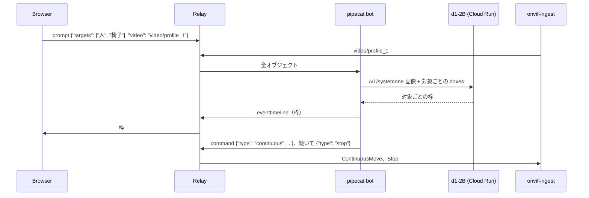

# moq-ptz-tracking

`onvif-ingest` が配信する ONVIF カメラの映像を pipecat の bot が受け取り、ブラウザの MoQ PTZ Tracking ページ（`examples/browser/examples/moq-ptz-tracking`）で指定した対象（最大 16）の位置を、決定モデル [d1-2B](https://huggingface.co/LiquidAI/d1-2B) に枠で尋ねます。
ページは枠を映像に重ねて描きます。枠が画面の端からはみ出しそうになると、bot は `onvif-ingest` に ContinuousMove と Stop を送り、すべての枠が画面に収まるようにカメラを向けます。



## 追従のしかた

- すべての枠を囲む枠が、画面の各辺から `--margin`（既定 0.1）より内側に収まっている軸は動かしません。はみ出した軸は、囲み枠の中心を画面の中央へ寄せます。
- カメラは、中心のずれに比例した時間だけ速度 0.5 の ContinuousMove で動かし、Stop で止めます。動かす時間は ずれ ÷ `--pan-per-second`（`--tilt-per-second`）秒です。
- 判定は 1 枚ずつ行い、カメラを動かしている間は判定しません。
- 対象を見失ったら、直前に動いていた向きへ 3 秒回しながら探します。見つからなければ (0, 0) に戻し、横へパンし続けながら探します。
- 1 回の判定は、Apple M1 Pro（MPS）で対象 1 つなら約 0.9 秒、1 つ増えるごとに約 0.45 秒増えます。

`--pan-per-second` と `--tilt-per-second` は、速度 0.5 で 1 秒動かしたときに映像が動く量（画面の幅・高さに対する割合）です。既定値は Tapo C2xx で測った `0.27` と `0.38` です。正のパンで左に回るカメラでは `--pan-per-second` を負にします。

## 起動

bot サービス（[`services/bots`](../../../docs/architecture/bots/architecture.md)）が、一時アプリごとに `ptz-tracking` 型の bot として起動します。
一時アプリのページは Join するときに temporary-apps の `/bots/ptz-tracking` を呼び、bot はページが 30 秒いないか 1 時間たつと抜けます。
ルームはアプリに 1 つ（`{app}/moq-ptz-tracking`）で、カメラもそのルームに配信します。Public モードのページでは bot は動きません。

ONVIF カメラは手元のネットワークにあるため、`onvif-ingest` は常に手元で起動します。リポジトリのルートの `.env` に `ONVIF_IP`・`ONVIF_USERNAME`・`ONVIF_PASSWORD` を設定し、
PTZ Tracking ページの共有リンクの `#jwt=` のトークンと、その appId（`temp-…`）でルームに配信します。

```shell
make onvif ONVIF_MOQT_URL=https://relay-1.moqt.research.skyway.io:443 \
  ONVIF_AUTH_TOKEN=<トークン> \
  ONVIF_PUBLISH_NAMESPACE=<appId>/moq-ptz-tracking/onvif/client \
  ONVIF_SUBSCRIBE_NAMESPACE=<appId>/moq-ptz-tracking/bots/ptz-tracking/command
```

- トークンは 1 時間で切れます。切れたらページの新しい共有リンクのトークンで起動し直します。
- 手元の relay と bot で試すときは、`uv sync` で `.venv` を作り、bots の `BOTS_TYPES` に次を足します（bots の起動は [moq-meeting-transcriber](../moq-meeting-transcriber/README.md) と同じです）。d1-2B の認証は [moq-camera-detection](../moq-camera-detection/README.md#d1-2b) と同じです。

```json
{
  "ptz-tracking": {
    "launcher": { "kind": "local", "program": "<リポジトリ>/examples/python/moq-ptz-tracking/.venv/bin/python" },
    "args": ["-m", "moq_ptz_tracking.bot", "--relay-url", "https://127.0.0.1:4433", "--insecure",
             "--system-one-url", "<System One の URL>/v1/systemone", "--gcloud-auth"],
    "grace_seconds": 30,
    "max_seconds": 3600,
    "max_running": 1
  }
}
```

## トラック

`{room}` は `{app}/moq-ptz-tracking`、`{app}` は一時アプリの appId（`temp-…`）です。

| namespace | track | 送信元 | 内容 |
| --- | --- | --- | --- |
| `{room}/page/viewer` | `prompt` | ブラウザ | `{"targets": ["...", ...], "video": "<映像トラック名>"}` で追従を始め、`{"targets": []}` で止める。対象は 1〜16 個 |
| `{room}/onvif/client` | `video/profile_N` | `onvif-ingest` | H.264 の LOC。bot は prompt の `video` のトラックを、追従している間だけ subscribe する |
| `{room}/bots/ptz-tracking/command` | `command` | bot | `onvif-ingest` の PTZ コマンド。1 回の動きを 1 group にし、`continuous` と `stop` を順に送る |
| `{room}/bots/ptz-tracking` | `eventtimeline` | bot | draft-ietf-moq-msf-02 §8 の event timeline。`data.boxes` は `[[対象の番号, [left, top, right, bottom]], ...]`、どの対象も映っていなければ `"not visible"` |
| `{room}/bots/ptz-tracking` | `status` | bot | d1-2B の起動状態 |

## テスト

```shell
uv run pytest
```
