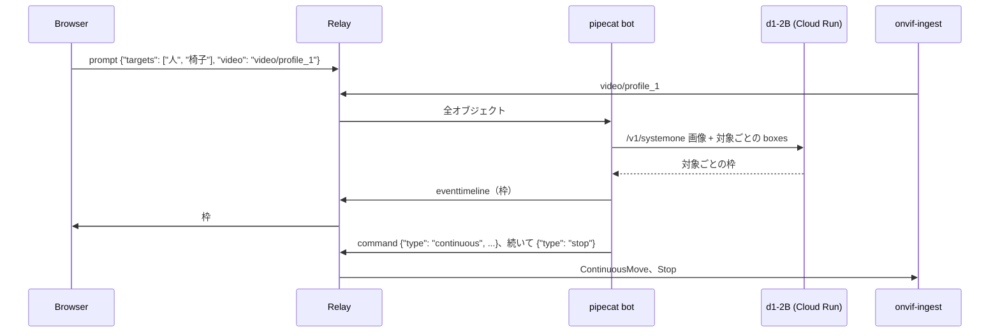

# moq-ptz-tracking

`onvif-ingest` が配信する ONVIF カメラの映像を pipecat の bot が受け取り、ブラウザの MoQ PTZ Tracking ページ（`examples/browser/examples/moq-ptz-tracking`）で指定した対象（最大 16）の位置を、決定モデル [d1-2B](https://huggingface.co/LiquidAI/d1-2B) に枠で尋ねます。
ページは枠を映像に重ねて描きます。枠が画面の端からはみ出しそうになると、bot は `onvif-ingest` に ContinuousMove と Stop を送り、すべての枠が画面に収まるようにカメラを向けます。



## 追従のしかた

- すべての枠を囲む枠が、画面の各辺から `--margin`（既定 0.1）より内側に収まっている軸は動かしません。はみ出した軸は、囲み枠の中心を画面の中央へ寄せます。
- カメラは、中心のずれに比例した時間だけ速度 0.5 の ContinuousMove で動かし、Stop で止めます。動かす時間は ずれ ÷ `--pan-per-second`（`--tilt-per-second`）秒です。
- 判定は 1 枚ずつ行い、カメラを動かしている間は判定しません。
- 対象を見失ったら、直前に動いていた向きへ 3 秒回しながら探します。見つからなければ (0, 0) に戻し、横へパンし続けながら探します。
- 1 回の判定は、Apple M1 Pro（MPS）で対象 1 つなら約 0.9 秒、1 つ増えるごとに約 0.45 秒増えます。

`--pan-per-second` と `--tilt-per-second` は、速度 0.5 で 1 秒動かしたときに映像が動く量（画面の幅・高さに対する割合）です。既定値は Tapo C2xx で測った `0.27` と `0.38` です。正のパンで左に回るカメラでは `--pan-per-second` を負にします。

## 起動

ONVIF カメラは手元のネットワークにあるため、`onvif-ingest` は常に手元で起動します。リポジトリのルートの `.env` に `ONVIF_IP`・`ONVIF_USERNAME`・`ONVIF_PASSWORD` を設定します。

### クラウドの relay と bot を使う

```shell
make onvif ONVIF_MOQT_URL=https://relay-1.moqt.research.skyway.io:443
```

ページを既定の Cloud relay-1 のまま Join すると、Cloud Run の bot（平日 9:00〜17:30、1 時間まで）がつながります。
Cloud relay-1 の `anon/onvif/*` は誰でも見られ、PTZ コマンドも誰でも送れます。

### 手元の relay と bot を使う

各コマンドを別々のターミナルで実行します。

```shell
make relay
make onvif

cd examples/python/moq-ptz-tracking
uv run python -m moq_ptz_tracking.bot --insecure \
  --system-one-url "$(gcloud run services describe moqt-system-one --region asia-southeast1 --format 'value(status.url)')/v1/systemone" \
  --gcloud-auth

make browser
make chrome
```

- d1-2B の認証は [moq-camera-detection](../moq-camera-detection/README.md#d1-2b) と同じです。bot のビルドには Rust のツールチェーンが要ります。
- bot は `http://127.0.0.1:8099` で待ち受けます。カメラが 1 台なので、ルームは `onvif` だけです。オプションは [moq-bot-rooms](../moq-bot-rooms/README.md) にあります。
- `make chrome` の Chrome でハブから MoQ PTZ Tracking を開き、Local relay-a を選んで Join します。対象を入力して「追従」を押すと bot がカメラを動かし始め、「停止」かページを閉じると止まります。

## トラック

`onvif-ingest` はカメラを `anon/onvif/client` にだけ publish するので、一時アプリの PTZ ルームにはカメラがありません。

| namespace | track | 送信元 | 内容 |
| --- | --- | --- | --- |
| `anon/moq-ptz-tracking/viewer` | `prompt` | ブラウザ | `{"targets": ["...", ...], "video": "<映像トラック名>"}` で追従を始め、`{"targets": []}` で止める。対象は 1〜16 個 |
| `anon/onvif/client` | `video/profile_N` | `onvif-ingest` | H.264 の LOC。bot は prompt の `video` のトラックを、追従している間だけ subscribe する |
| `anon/onvif/viewer` | `command` | bot | `onvif-ingest` の PTZ コマンド。1 回の動きを 1 group にし、`continuous` と `stop` を順に送る |
| `anon/moq-ptz-tracking/tracker` | `eventtimeline` | bot | draft-ietf-moq-msf-01 §8 の event timeline。`data.boxes` は `[[対象の番号, [left, top, right, bottom]], ...]`、どの対象も映っていなければ `"not visible"` |
| `anon/moq-ptz-tracking/tracker` | `status` | bot | d1-2B の起動状態 |

## テスト

```shell
uv run pytest
```
