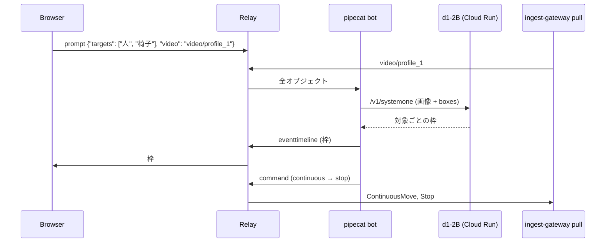

# moq-ptz-tracking

`ingest-gateway pull` のカメラ映像から [d1-2B](https://huggingface.co/LiquidAI/d1-2B) で指定対象（最大 16 個）を検出し、全枠が画面内に収まるよう PTZ コマンド（`ContinuousMove` / `Stop`）を送る Pipecat bot です。ブラウザ（`examples/browser/examples/moq-ptz-tracking`）が枠を重ねて表示します。



## 追従ロジック

- 全枠の外接矩形が各辺から `--margin`（既定 `0.1`）の内側にある軸は動かさず、はみ出した軸だけ中央へ寄せます。
- 速度 `0.5` の `ContinuousMove` を `ずれ ÷ --pan-per-second`（または `--tilt-per-second`）秒送り、`Stop` で止めます（カメラ移動中は推論しません）。
- `--pan-per-second` / `--tilt-per-second` は速度 `0.5` で 1 秒あたりの画面比移動量（既定 `0.27` / `0.38`、Tapo C2xx 実測値。正パンで左回転する機種は負値を指定）。
- 見失った場合は直前の向きへ 3 秒探索し、見つからなければ `(0, 0)` に戻して横パン探索を続けます。
- 推論速度の目安（Apple M1 Pro MPS）: 対象 1 つで約 0.9 秒、+1 ごとに約 +0.45 秒。

## 起動

一時アプリ（ルーム `{app}/moq-ptz-tracking`、Public モード不可）で Join 後「bot を参加させる」を押すと、[`bot-dispatcher`](../../../services/bot-dispatcher/README.md) が `ptz-tracking` を起動します（参加者がいない状態が 30 秒続くか、最大 1 時間で終了）。

LAN 上のカメラを繋ぐため `ingest-gateway pull` は手元で起動します。ルート `.env` に `ONVIF_IP`・`ONVIF_USERNAME`・`ONVIF_PASSWORD` を設定し、共有リンクの `#jwt=` トークンと `appId` を渡します（トークンは 1 時間で切れるため、切れたらページの新しい共有リンクのトークンで起動し直します）:

```shell
make onvif ONVIF_MOQT_URL=https://relay-1.moqt.research.skyway.io:443 \
  ONVIF_AUTH_TOKEN=<トークン> \
  ONVIF_PUBLISH_NAMESPACE=<appId>/moq-ptz-tracking/onvif/client \
  ONVIF_SUBSCRIBE_NAMESPACE=<appId>/moq-ptz-tracking/bots/ptz-tracking/command
```

ローカルで bot も動かす場合は `uv sync` 後、`BOT_DISPATCHER_TYPES` に追加します（d1-2B 認証: [moq-camera-detection](../moq-camera-detection/README.md#d1-2b)、共通オプション: [moq-bot-job](../moq-bot-job/README.md)）:

```json
{
  "ptz-tracking": {
    "launcher": { "kind": "local", "program": "<リポジトリ>/examples/python/moq-ptz-tracking/.venv/bin/python" },
    "args": ["-m", "moq_ptz_tracking.bot", "--relay-url", "https://127.0.0.1:4433", "--insecure",
             "--system-one-url", "<System One の URL>/v1/systemone", "--gcloud-auth"],
    "grace_seconds": 30,
    "max_seconds": 3600,
    "max_running": 1
  }
}
```

## トラック

`{room}` = `{app}/moq-ptz-tracking`（`{app}` は `temp-…`）。

| namespace | track | 送信元 | 内容 |
| --- | --- | --- | --- |
| `{room}/page/viewer` | `prompt` | ブラウザ | `{"targets": [...], "video": "<track>"}`（1〜16 個、空配列で停止） |
| `{room}/onvif/client` | `video/profile_N` | `ingest-gateway pull` | H.264 LOC（追従中のみ購読） |
| `{room}/bots/ptz-tracking/command` | `command` | bot | PTZ コマンド（1 動作 1 group で `continuous` → `stop`） |
| `{room}/bots/ptz-tracking` | `eventtimeline` | bot | `draft-ietf-moq-msf-02` §8 の event timeline。`data.boxes` に `[[idx, [l, t, r, b]], ...]`、どの対象も映っていなければ `"not visible"` |
| `{room}/bots/ptz-tracking` | `status` | bot | d1-2B の起動状態 |

## テスト

```shell
uv run pytest
```
