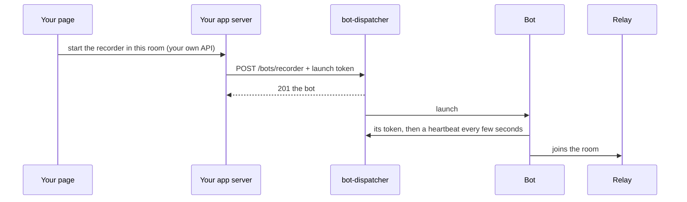

# bot-dispatcher

Starts bots (a recorder, AI bots) in a room for your app's server.
Design: [architecture document](../../docs/architecture/bot-dispatcher/architecture.md).

## Starting a bot from your app

A browser never calls bot-dispatcher. Your page asks your own server, your
server decides whether that user may start the bot, and only then calls
bot-dispatcher with a launch token it signs with the app's secret:



Pages of a temporary app have no server of their own; `services/temporary-apps`
plays that server for them.

## The launch token

A launch token is a JWT signed like a client token
([Signing tokens on your own server](../console/README.md#signing-tokens-on-your-own-server)):
HS256 with the UTF-8 bytes of your app's secret. Its claims differ:

| Claim | Value |
| --- | --- |
| `appId` | Your app's `appId` |
| `bots` | Path under your app whose rooms the token may start, stop and read bots in: `team-a` covers `<appId>/team-a` and below, `""` the whole app |
| `iat`, `exp` | Unix seconds; `exp - iat` at most 5 minutes |

Leave out `publish` and `subscribe`, so a leaked launch token cannot join a
room. Sign one per call.

```python
import base64, hashlib, hmac, json, time

def b64url(data: bytes) -> str:
    return base64.urlsafe_b64encode(data).rstrip(b"=").decode()

def launch_token(app_id: str, secret: str, bots: str = "") -> str:
    now = int(time.time())
    claims = {"appId": app_id, "bots": bots, "iat": now, "exp": now + 60}
    signing_input = b64url(b'{"alg":"HS256"}') + "." + b64url(json.dumps(claims).encode())
    signature = hmac.new(secret.encode(), signing_input.encode(), hashlib.sha256).digest()
    return signing_input + "." + b64url(signature)
```

## API

Send the launch token as `Authorization: Bearer <token>` on every route below.

| Route | Answer |
| --- | --- |
| `POST /bots/{type}` `{"namespace_prefix", "options"}` | `201` the bot |
| `GET /bots/{type}?namespace_prefix=` | `200` the room's latest bot of that type, `404` if it never had one |
| `GET /bots/{type}/{id}` | `200` the bot |
| `DELETE /bots/{type}/{id}` | `202`; the bot stops at its next heartbeat |
| `GET /healthz` | `200 {"status": "ok"}` |

`namespace_prefix` is the room, the full namespace `<appId>/<room>`.
`options` is optional and depends on the type (below).

```
POST /bots/recorder
Authorization: Bearer eyJhbGci...
Content-Type: application/json
{ "namespace_prefix": "<appId>/weekly-sync", "options": { "composite": true } }

201 Created
{
  "id": "0d90e0a9221b4d7ea633c39dc451d129",
  "type": "recorder",
  "namespace_prefix": "<appId>/weekly-sync",
  "state": "starting",
  "created_at_ms": 1795007144545,
  "updated_at_ms": 1795007144545
}
```

| Status | `error` | Meaning |
| --- | --- | --- |
| `400` | `invalid_request` | The body is not JSON with `namespace_prefix`, or `namespace_prefix` is missing from the query |
| `400` | `invalid_room` | `namespace_prefix` has fewer than two elements or an empty one |
| `401` | `a bearer token is required` | No `Authorization: Bearer` header |
| `401` | `invalid_token` | The token is not signed with a registered app's secret |
| `401` | `invalid_token_lifetime` | The token has expired, lives longer than 5 minutes, lacks `iat` or `exp`, or has an empty element in `bots` |
| `403` | `forbidden` | The `bots` claim is missing or does not cover the room, or the app is a relay |
| `404` | `not_found` | The type is not deployed, or no such bot of that type |
| `409` | `conflict` | The room already runs a bot of that type |
| `503` | `full` | The type runs as many bots as it may, over all apps |
| `500` | `internal_error` | The bot could not be launched or the store failed; the room's latest bot then shows a `failed` launch, and you may retry |
| `503` | `vts_unavailable` | The token could not be verified; retry |

## Bot states

| `state` | Meaning |
| --- | --- |
| `starting` | Launched, not yet reporting |
| `running` | In the room |
| `stopping` | A `DELETE` is waiting for the bot's next heartbeat |
| `finished` | Left the room |
| `failed` | Could not launch, crashed, or stopped reporting; see `error` |

A bot that has not reported for 90 s, or has not reported at all 5 minutes
after its launch, is
`failed` with `the bot stopped reporting`, and the room may start another.

A bot ends by itself once the room has had no member who publishes for its
type's `grace_seconds`, counted from its start too, and after its type's
`max_seconds` ([Configuration](#configuration)).

## Bot types and options

Which types exist depends on the deployment (`BOT_DISPATCHER_TYPES` below).
This repository's bots:

| Type | Does | `options` |
| --- | --- | --- |
| `recorder` | Records every participant of the room ([`services/recorder`](../recorder/README.md)) | `layout`: `combined` (default, video and audio in one file) or `per-track`; `composite`: `true` to also mix everyone into one `composite.mp4` (default `false`); `format`: `mp4` (default) or `moq`, a recording that can be replayed through the relay |
| `transcriber` | Publishes live captions ([moq-meeting-transcriber](../../examples/python/moq-meeting-transcriber/README.md)) | `asr`: the recognizer, `whisper` by default or one the deployment offers |
| `chat-moderation` | Moderates the chat ([moq-chat-moderation](../../examples/python/moq-chat-moderation/README.md)) | — |
| `camera-detection` | Finds what is asked for in a camera ([moq-camera-detection](../../examples/python/moq-camera-detection/README.md)) | — |
| `ptz-tracking` | Points a PTZ camera at what is asked for ([moq-ptz-tracking](../../examples/python/moq-ptz-tracking/README.md)) | — |
| `voice-agent` | Talks with the room ([moq-ai-voice-agent](../../examples/python/moq-ai-voice-agent/README.md)) | — |

bot-dispatcher passes `options` on unchecked: a bot given an invalid one, or a
recorder given `composite` with `format: moq`, turns `failed` with the reason
in `error`.

A recorder's bot id is not its recording's id: list the room's recordings with
`GET /recordings?namespace_prefix=` of `recorder serve`.

## The bot in the room

A bot joins with a one-hour token bot-dispatcher signs for your app, which
subscribes to the whole room and publishes only under `<room>/bots/<type>`. A page learns that a bot joined from that
namespace's PUBLISH_NAMESPACE and that it left from its
PUBLISH_NAMESPACE_DONE, so leave `bots` out of the names your members publish
under.

## Configuration

| Variable | Default | Meaning |
| --- | --- | --- |
| `BOT_DISPATCHER_PUBLIC_URL` | required | URL the bots call back, and the audience of their Google ID tokens |
| `BOT_DISPATCHER_TYPES` | required | The bot types, JSON (below) |
| `BOT_DISPATCHER_STORE_URL` | required | `gs://<bucket>/<prefix>` or `file:///<dir>/`: one record per bot and a lock per room and type; `file://` cannot lock, so run one instance on it |
| `BOT_DISPATCHER_VTS_URL` | required without `BOT_DISPATCHER_INSECURE_SKIP_AUTH` | VTS `/verify` endpoint that checks launch tokens |
| `BOT_DISPATCHER_REGISTRY_FILE` | unset | Registered apps in a local file, whose secrets sign the bot tokens; this or the bucket is required without `BOT_DISPATCHER_INSECURE_SKIP_AUTH` |
| `BOT_DISPATCHER_REGISTRY_BUCKET`, `BOT_DISPATCHER_REGISTRY_OBJECT` | unset, `registry.json` | Read the registered apps from Cloud Storage instead |
| `BOT_DISPATCHER_TEMPORARY_APP_SECRET` | unset | Secret of every temporary app; unset, a temporary app's bot gets no token |
| `BOT_DISPATCHER_JOB_SERVICE_ACCOUNT` | unset | Comma-separated service accounts the Cloud Run jobs run as; unset accepts only locally launched bots |
| `BOT_DISPATCHER_INSECURE_SKIP_AUTH` | unset | `true` accepts every request and lets bots join with no token, for a relay without authorization (local development only) |
| `PORT` | `8098` | Listen port |

Logging and OTLP export follow `crates/telemetry-otlp`
(`BOT_DISPATCHER_STDOUT_FILTER` and the standard `OTEL_*` variables).

`BOT_DISPATCHER_TYPES` maps each type to how it is launched and its limits:

```json
{
  "recorder": {
    "launcher": { "kind": "cloud-run", "job": "projects/<p>/locations/<r>/jobs/<job>" },
    "args": ["bot", "--relay", "https://relay.example.com:4433", "--store", "gs://<bucket>/recordings"],
    "grace_seconds": 300,
    "max_seconds": 7200,
    "max_running": 4
  }
}
```

- `launcher` is `{"kind": "cloud-run", "job": ...}`, for which
  bot-dispatcher's service account needs `run.jobs.runWithOverrides` on the
  job, or `{"kind": "local", "program": <path>}`, a child process.
- A bot runs `args` followed by `--bot-type`, `--bot-id`,
  `--bot-dispatcher-url`, `--namespace-prefix`, `--grace-seconds`,
  `--max-seconds` and, when the request has them, `--options <JSON>`. A
  locally launched bot also finds its key in `BOT_DISPATCHER_BOT_KEY`.

## Running

With a relay without authorization running locally, build the recorder
(`cargo build -p recorder`) and start bot-dispatcher with the recorder as a
child process:

```
BOT_DISPATCHER_PUBLIC_URL=http://127.0.0.1:8098 \
BOT_DISPATCHER_STORE_URL=file://$PWD/recordings/bots/ \
BOT_DISPATCHER_INSECURE_SKIP_AUTH=true \
BOT_DISPATCHER_TYPES='{"recorder": {"launcher": {"kind": "local", "program": "target/debug/recorder"},
  "args": ["bot", "--relay", "https://127.0.0.1:4433", "--insecure-skip-tls-verify", "--store", "file://'$PWD'/recordings/store/"],
  "grace_seconds": 300, "max_seconds": 7200, "max_running": 4}}' \
  cargo run -p bot-dispatcher

curl -X POST http://127.0.0.1:8098/bots/recorder \
  -H 'Content-Type: application/json' -d '{"namespace_prefix": "anon/research"}'
```

`compose.demo.yml` runs it with the voice agent (`--profile voice-agent`).
