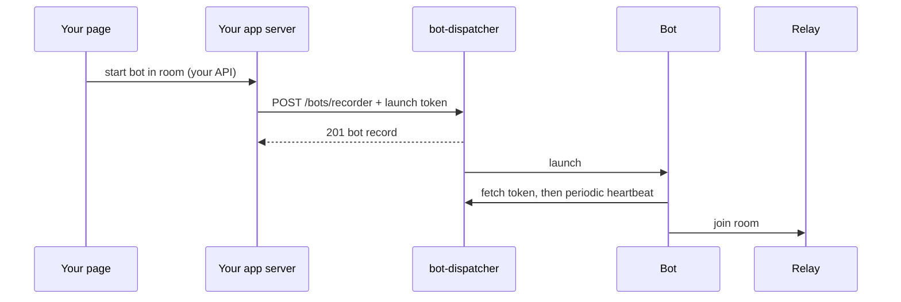

# bot-dispatcher

Launches and manages room bots (recorder, AI bots) on behalf of your app server. Design: [architecture.md](../../docs/architecture/bot-dispatcher/architecture.md).

## Flow

Browsers never call `bot-dispatcher` directly. Your page asks your app server, which authorizes the user and calls `bot-dispatcher` with a short-lived launch token signed using the app's secret:



For temporary apps (which have no app server), `services/temporary-apps` proxies these requests.

## Launch token

HS256 JWT signed with the UTF-8 bytes of your app's secret (same signing as [client tokens](../console/README.md#signing-tokens-on-your-own-server)):

| Claim | Value |
| --- | --- |
| `appId` | Your app's `appId` |
| `bots` | Allowed room path prefix under `appId` (`team-a` covers `<appId>/team-a/**`; `""` covers the whole app) |
| `iat`, `exp` | Unix seconds; `exp - iat` must be ≤ 5 minutes |

Omit `publish` and `subscribe` so a leaked launch token cannot join a room. Sign a fresh token per request.

```python
import base64, hashlib, hmac, json, time

def b64url(data: bytes) -> str:
    return base64.urlsafe_b64encode(data).rstrip(b"=").decode()

def launch_token(app_id: str, secret: str, bots: str = "") -> str:
    now = int(time.time())
    claims = {"appId": app_id, "bots": bots, "iat": now, "exp": now + 60}
    signing_input = b64url(b'{"alg":"HS256"}') + "." + b64url(json.dumps(claims).encode())
    signature = hmac.new(secret.encode(), signing_input.encode(), hashlib.sha256).digest()
    return signing_input + "." + b64url(signature)
```

## API

Pass the launch token as `Authorization: Bearer <token>` on all `/bots/*` routes (`namespace_prefix` is `<appId>/<room>`; `options` is optional and type-specific):

| Route | Response |
| --- | --- |
| `POST /bots/{type}` `{"namespace_prefix", "options"}` | `201` bot record |
| `GET /bots/{type}?namespace_prefix=` | `200` latest bot for that room/type, or `404` |
| `GET /bots/{type}/{id}` | `200` bot record |
| `DELETE /bots/{type}/{id}` | `202` (stops on next heartbeat) |
| `GET /healthz` | `200 {"status": "ok"}` |

```
POST /bots/recorder
Authorization: Bearer eyJhbGci...
Content-Type: application/json
{ "namespace_prefix": "<appId>/weekly-sync", "options": { "composite": true } }

201 Created
{
  "id": "0d90e0a9221b4d7ea633c39dc451d129",
  "type": "recorder",
  "namespace_prefix": "<appId>/weekly-sync",
  "state": "starting",
  "created_at_ms": 1795007144545,
  "updated_at_ms": 1795007144545
}
```

While a bot's latest heartbeat reports a type-specific JSON object as `output`, `GET` responses include `"output"` (absent otherwise, so `201` never has it); a bot that wants it shown sends it with every heartbeat. For example, a running recorder returns `"output": {"recording_id": "1795007144545-a1b2c3"}`.

| Status | `error` | Meaning |
| --- | --- | --- |
| `400` | `invalid_request` | Invalid JSON body or missing `namespace_prefix` |
| `400` | `invalid_room` | `namespace_prefix` has fewer than 2 segments or an empty segment |
| `401` | `a bearer token is required` | Missing `Authorization: Bearer` header |
| `401` | `invalid_token` | Signature verification failed |
| `401` | `invalid_token_lifetime` | Expired, lifetime > 5 min, missing `iat`/`exp`, or empty segment in `bots` |
| `403` | `forbidden` | `bots` claim missing or doesn't cover the room, or app is a relay |
| `404` | `not_found` | Unknown bot type or bot ID |
| `409` | `conflict` | A bot of this type is already active in the room |
| `503` | `full` | Global `max_running` limit reached for this type |
| `500` | `internal_error` | Launch or store failure (query `GET /bots/{type}?namespace_prefix=` before retrying; only a launcher error attempts to mark the bot `failed`) |
| `503` | `vts_unavailable` | VTS unreachable; retry |

## Bot states

| `state` | Meaning |
| --- | --- |
| `starting` | Launched, awaiting first report |
| `running` | Active in the room |
| `stopping` | `DELETE` received, awaiting next heartbeat |
| `finished` | Exited cleanly |
| `failed` | Launch failed, crashed, or timed out (see `error`) |

- A bot is marked `failed` (`the bot stopped reporting`) if it misses heartbeats for 90 s or fails to report within 5 min of launch, freeing the room to start another.
- Bots exit automatically after `grace_seconds` with no active publishers (including at startup) or after `max_seconds`.

## Bot types and options

Deployed types come from `BOT_DISPATCHER_TYPES`. Built-in bots:

| Type | Purpose | `options` |
| --- | --- | --- |
| `recorder` | Records every participant ([`services/recorder`](../recorder/README.md)) | `layout`: `combined` (default) or `per-track`; `composite`: `true` to also mix everyone into `composite.mp4` (default `false`); `format`: `mp4` (default) or `moq` (replayable through the relay) |
| `transcriber` | Live captions ([`moq-meeting-transcriber`](../../examples/python/moq-meeting-transcriber/README.md)) | `asr`: `whisper` (default) or another configured recognizer |
| `chat-moderation` | Chat moderation ([`moq-chat-moderation`](../../examples/python/moq-chat-moderation/README.md)) | — |
| `camera-detection` | Camera Q&A and bounding boxes ([`moq-camera-detection`](../../examples/python/moq-camera-detection/README.md)) | — |
| `ptz-tracking` | PTZ camera auto-tracking ([`moq-ptz-tracking`](../../examples/python/moq-ptz-tracking/README.md)) | — |
| `voice-agent` | Conversational voice agent ([`moq-ai-voice-agent`](../../examples/python/moq-ai-voice-agent/README.md)) | — |

`options` are forwarded unchecked; invalid options (such as `composite: true` with `format: moq`) cause the bot to enter `failed` with the reason in `error`.

Note: a recorder bot's `id` differs from its recording ID. Once the recording exists, the bot reports `"output": {"recording_id": "<id>"}` (absent if it fails before creating the recording); pass `output.recording_id` to `GET /recordings/{id}` on `recorder serve` (or list via `GET /recordings?namespace_prefix=`).

## Room namespace

Bots join with a 1-hour token that subscribes to `<room>` and publishes only under `<room>/bots/<type>`. Pages detect bot arrival/departure via `PUBLISH_NAMESPACE` / `PUBLISH_NAMESPACE_DONE` on that prefix, so avoid naming user participants `bots`.

## Configuration

| Variable | Default | Meaning |
| --- | --- | --- |
| `BOT_DISPATCHER_PUBLIC_URL` | required | Callback URL for bots and Google ID token audience |
| `BOT_DISPATCHER_TYPES` | required | JSON map of bot types (see below) |
| `BOT_DISPATCHER_STORE_URL` | required | `gs://<bucket>/<prefix>` or `file:///<dir>/` (`file://` has no locking; single instance only) |
| `BOT_DISPATCHER_VTS_URL` | required* | VTS `/verify` endpoint |
| `BOT_DISPATCHER_REGISTRY_FILE` | unset | Local app registry file used to sign bot tokens (this or bucket required*) |
| `BOT_DISPATCHER_REGISTRY_BUCKET`, `BOT_DISPATCHER_REGISTRY_OBJECT` | unset, `registry.json` | Cloud Storage app registry |
| `BOT_DISPATCHER_TEMPORARY_APP_SECRET` | unset | Signing secret for temporary apps (unset disables temporary-app bot tokens) |
| `BOT_DISPATCHER_JOB_SERVICE_ACCOUNT` | unset | Comma-separated Cloud Run job service accounts (unset allows local bots only) |
| `BOT_DISPATCHER_INSECURE_SKIP_AUTH` | unset | `true` skips auth and issues no bot token (local dev only) |
| `PORT` | `8098` | Listen port |

\*Not required when `BOT_DISPATCHER_INSECURE_SKIP_AUTH=true`. Logging/OTLP use `BOT_DISPATCHER_STDOUT_FILTER` and standard `OTEL_*` variables (`crates/telemetry-otlp`).

`BOT_DISPATCHER_TYPES` example:

```json
{
  "recorder": {
    "launcher": { "kind": "cloud-run", "job": "projects/<p>/locations/<r>/jobs/<job>" },
    "args": ["bot", "--relay", "https://relay.example.com:4433", "--store", "gs://<bucket>/recordings"],
    "grace_seconds": 300,
    "max_seconds": 7200,
    "max_running": 4
  }
}
```

- `launcher`: `{"kind": "cloud-run", "job": ...}` (requires `run.jobs.runWithOverrides`) or `{"kind": "local", "program": <path>}`.
- `bot-dispatcher` appends `--bot-type`, `--bot-id`, `--bot-dispatcher-url`, `--namespace-prefix`, `--grace-seconds`, `--max-seconds`, and (if present) `--options <JSON>` to `args`. Local bots receive their auth key in `BOT_DISPATCHER_BOT_KEY`.

## Running locally

With an unauthenticated local relay running, build the recorder (`cargo build -p recorder`) and start `bot-dispatcher`:

```shell
BOT_DISPATCHER_PUBLIC_URL=http://127.0.0.1:8098 \
BOT_DISPATCHER_STORE_URL=file://$PWD/recordings/bots/ \
BOT_DISPATCHER_INSECURE_SKIP_AUTH=true \
BOT_DISPATCHER_TYPES='{"recorder": {"launcher": {"kind": "local", "program": "target/debug/recorder"},
  "args": ["bot", "--relay", "https://127.0.0.1:4433", "--insecure-skip-tls-verify", "--store", "file://'$PWD'/recordings/store/"],
  "grace_seconds": 300, "max_seconds": 7200, "max_running": 4}}' \
  cargo run -p bot-dispatcher

curl -X POST http://127.0.0.1:8098/bots/recorder \
  -H 'Content-Type: application/json' -d '{"namespace_prefix": "anon/research"}'
```

`compose.demo.yml --profile voice-agent` runs `bot-dispatcher` with the voice agent.
